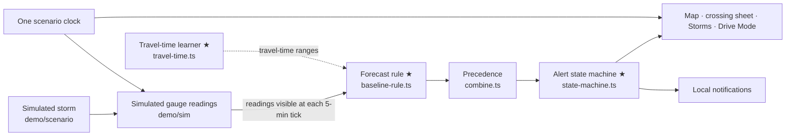

# FordCast DEMO EDITION — Part 6: Video & submission (§29–§33)

> Addressed to the AI coding agent, with the student's own tasks marked **(S)**. This part turns the built app into the 2:15–2:30 video judges watch, keeps every frame honest, and gets the entry submitted on **Sun Oct 25, 2026**.
>
> **Division of labor.** *Agent:* prepares takes in the Demo Director, checks every clip and sentence against §31, drafts captions and docs, runs §33. *Student:* records the takes and the voice-over (own voice), edits, writes Q1–Q4 in their own words, uploads, and presses Submit. Uploading, making the repo public and submitting are stop-and-ask actions (§1.7 #4).
>
> Tags and evidence labels are defined at the top of `01-scope-rules-plan.md`. Take IDs (`T01-calm` … `T11-unknown`, `O1-closed` … `O4-onion-result`) are the `TAKES` entries of `mobile/src/demo/scenario/takes.ts` (port of `proto/takes.ts`); every storm time below is **computed by the engine** [Verified: research-data §3, §7 — prototype run 2026-10-16].

---

## §29. Video plan & shot list mapped to scenario keyframes

### 29.1 Specs

| Item | Choice | Source / note |
|---|---|---|
| Length | **2:15–2:30**; hard cap **3:00** | "DEMONSTRATION VIDEO (max 3 min)" [Secondary: 2026 House-member CAC page via web search, 2026-10-16]; 2025 rules say over-length videos "may be penalized" [Secondary: 2025 CAC rules PDF] |
| Required content | Each participant's **name**, the **app name**, its **purpose in one sentence**, the **target audience**, the **tools used**, and a **demonstration** of how it works | [Secondary: 2025 CAC rules PDFs (mfume.house.gov, morgangriffith.house.gov) + 2026 member pages, via web search]. VERIFY BEFORE USE against the official 2026 rules (§32.1). |
| Host / visibility | YouTube (or Vimeo); **Public** by default — the 2025 rules say "The video must be set to 'public'" | [Secondary: 2025 CAC rules PDF]. Use Unlisted only if the 2026 rules the student reads allow it (DD14). |
| Format | 16:9, **1920×1080** delivery, 30 fps (60 if UI motion stutters at 30); edit on a 4K timeline for clean punch-ins | Phone footage sits in a device frame on a `#0E1726` canvas |
| App footage | **≥ 60 %** of runtime (plan below: ≈ 79 %) | full-build rule (E §41.1) |
| Voice | The **student's own voice**; no AI voice, AI avatar or generated footage | AI-integrity rule (E §39.2 #7) |
| Captions | Hand-corrected **EN SRT** + **ES SRT**; burned-in text only for kinetic numbers and the honesty title card | §29.7 |
| Honesty | Opening title card + in-app labels in every storm frame + "in this simulated storm" in the VO + end card (§31.2) | §31 |
| Photosensitivity | Nothing flashes more than 3× per second; no lightning/strobe B-roll | WCAG 2.3.1 |
| Audio | VO first; app TTS about −12 dB under the voice; music (optional) ducked well under both; loudness ≈ −14 LUFS integrated, peaks ≤ −1 dBTP [Unverified: YouTube normalization] | — |

### 29.2 Story arc (problem → solution → proof → trust)

`Hook → Problem → Who + purpose + honesty card → Calm map → How it knows → SIMULATED STORM (signature) → Result → One clock → Lock-screen warning → Detour → Drive Mode EN/ES → Unknown, never "safe" → Tools + AI disclosure + next → What's real + end card.` It follows the five beats of §2.3 and the research-ui §1.5 / research-data §7 beat maps, merged and re-timed to add the CAC-required "tools used" and "target audience" content.

### 29.3 Shot list (target 2:30; the student writes the final VO wording)

"VO outline" is a guide, not the student's words (§32.3 rule: the agent never writes the final narration). Every spoken claim must map to a `docs/CLAIMS.md` row (§31.4, IDs in brackets).

| Time | Segment | Take · scenario @ storm time · speed | Screen · gesture | Must be on screen | VO outline (student finalizes) | On-screen text (burned in) | App s |
|---|---|---|---|---|---|---|---|
| 0:00–0:08 | Hook | B-roll (own footage, §29.8): a **dry** low-water crossing with its depth-marker post, or rain on a windshield in a **parked** car | — | — | The most dangerous part of a Central Texas flood isn't the river — it's the road. | **TEXAS — #1 IN U.S. FLOOD DEATHS** · small "1959–2019 [S1]" | 0 |
| 0:08–0:18 | Problem | Kinetic text over dark B-roll | — | — | Over half of flood drownings happen when someone drives into water; today's tools say a crossing is closed only after the water is already over it. | "570 vehicle-related deaths [S2]" → "Over half of flood drownings: driving into water [S3]" | 0 |
| 0:18–0:28 | Who · purpose · audience · honesty | iPhone Home Screen → tap the FordCast icon → launch "arrival" (§20) | icon, splash, calm map appears | app icon; DEMO chip | I'm [NAME], a 9th grader at [SCHOOL] in [CITY]. FordCast warns drivers — especially at night and new drivers — which low-water crossing is likely to flood soon, before the water reaches the road. [D02] | **Title card (≥ 2.5 s):** "This demonstration uses simulated storms. The forecasting code is real and runs on the phone." | 4 |
| 0:28–0:38 | Calm | **T01-calm** · `calm-evening` @ 8:00 PM · paused | Map Home; no touch, then one slow pinch-out | DEMO chip; 17 monitored crossings ○ No rise detected; tier-C ◌ not monitored; "Watching 12 upstream gauges for 17 crossings" | FordCast watches the stream gauges upstream of each low-water crossing. On a calm night it never says "safe" — just "no rise detected". [D10] | — | 10 |
| 0:38–0:50 | How it knows | **T02-rising** · `flash-flood-night` @ 6:48 AM (Watch + 3) · paused | tap the Jones Rd marker → drag the sheet to half | ▲ Watch "water rising upstream"; hydrograph climbing toward the dashed 6.0 ft trigger line; "Water usually takes 30–45 min to get here" | When rain hits upstream, the gauge rises first — and FordCast knows how long the water usually takes to reach this road: 30 to 45 minutes. [D06, D08] | — | 12 |
| 0:50–1:20 | **Signature: simulated storm** | **T03-player** · `flash-flood-night` from 6:35 AM · 60× + auto-slow | Storms → `[▶ Play]` on the hero card (record from the card tap), then touch nothing | SIMULATED STORM banner every frame; 6:45 ▲; **7:00 ◆ "likely flooded within 15–30 min"**; cyan wave + wavefront dot reaching Jones Rd; 7:30 ● water on the road; storm clock visible | Here's a simulated storm. Watch the water travel down Williamson Creek. Jones Road turns Watch, then Avoid — likely flooded within 15 to 30 minutes — and half an hour later the water reaches the road. [D01, D02] | kinetic stamps synced to the ticks: "6:45 Watch" · "7:00 Avoid" · "7:30 water on the road" | 30 |
| 1:20–1:30 | Result | **T04-results** · @ 7:55 AM · paused | `storm/results` auto-presents; one drag to full | count-up **30**; `demo.result`; honesty line (n = 3, m = 30); rule line; closure gap 50; window check "inside" | In this simulated storm, FordCast said Avoid 30 minutes before the water reached the road — and 50 minutes before the road crew closed it. A fixed rule picked this example: the one closest to the median. [D03, D04, D05] | **"30 MIN EARLIER · in this simulated storm"** | 10 |
| 1:30–1:36 | One clock | **T05-one-clock** · @ 7:02 AM · paused | tap ✕ on the player | Map Home with violet frame + SIMULATED pill + accessory; Jones Rd ◆ 15–30; Westgate ▲, Manchaca & Jones ▲, Jimmy Clay ▲ | It's not just a replay screen: the same clock drives the whole app. [D01] | — | 6 |
| 1:36–1:46 | Lock screen | **T06-lockscreen → T07-sheet** · arm @ 6:59 → 7:00 AM | Director "Lock-screen take" → side button → ≈ 8 s → banner → tap → Face ID → drag to half | Banner "Avoid Williamson Creek at Jones Road" / "Simulated storm · demo data" / "Likely flooded within 15–30 min…"; then the sheet ◆ Avoid 15–30 + reasons | If Jones Road is on your way to school, your phone warns you — even when it's locked. [D13] | — | 10 |
| 1:46–1:57 | Detour | **T08-detour** · @ 7:01 AM · paused | `[Detour +N min]` → `drive/result` → `[Start Drive Mode]` | verdict Avoid (Jones Rd) + Watch (Manchaca & Jones); "Detour adds N min" (baked duration); detour drawn on real streets | One tap shows a way around it. [D15] | — | 11 |
| 1:57–2:10 | Drive Mode EN → ES | **T09-drive-en** (drive 56 → 80 s, 1×) then **T10-drive-es** (60 → 76 s) · `drive-commute` | none (phone in a mount) | SIMULATED DRIVE label every frame; at drive 66 s: chime → "2 crossings ahead changed. Avoid Williamson Creek at Jones Road. Flooding likely soon. Take another route." + red edge glow; ES: "Cambiaron 2 cruces adelante. Evite Williamson Creek en Jones Road…" | While you drive, FordCast speaks — in English or Spanish — so your eyes stay on the road. [D14, D17] | EN caption under the Spanish audio | 13 |
| 2:10–2:15 | Unknown, never "safe" | **T11-unknown** · `onion-creek-storm` @ 5:50 AM · paused | player, Bluff Springs Rd selected | ◌ Unknown; "Last known: Avoid · 50 min ago"; caption "Onion Ck at Twin Creeks Rd went silent…" | If a gauge goes silent, FordCast says Unknown. It never pretends a road is fine. [D11] | — | 5 |
| 2:15–2:24 | Tools · AI · next | `settings/how-it-works` (animated travel dot) | none | the 5-step diagram | I built it in TypeScript with React Native and Expo, MapLibre maps, and Xcode on my own iPhone, with help from an AI coding assistant. I wrote the forecast rule, the alert state machine and the travel-time code myself. Next: live USGS gauges and testing on real past storms. [D21, D25, D26, D27] | "Tools: TypeScript · React Native (Expo SDK 57) · MapLibre + OpenFreeMap · Xcode · AI assistant: Claude Code (disclosed in AI_USE.md)" | 5 |
| 2:24–2:30 | Trust + end | `settings/whats-real` flash (≈ 3 s) → end card | none | Real / Simulated / Planned groups | The storms here are simulated; the code is real. In a flood, minutes matter — FordCast tries to win some of them back. Turn around, don't drown. | End card (§31.2) | 3 |

**App-footage share:** 119 s of 150 s ≈ 79 %. Recompute from the final edit (count only frames showing FordCast's UI or its notification); if it falls below 60 %, trim Hook/Problem, never app footage. If a [SHOULD-SHOW] cut (§6.3) removes a shot, replace its seconds with the crossing sheet or Map Home, never with new claims.

**Optional inserts** (only if the cut is under 2:25): **O1-closed** (7:50 AM, ▧ Flooded – Closed · OFFICIAL, "Simulated road crew"; 3 s; [D12]) · **O2-sensor** (8:15 AM, Manchaca & Jones "Water over road", 3 s) · **O3-lockout** (passenger hold, 3 s; [D23]) · **O4-onion-result** (35 min, Onion Creek storm; 3 s; [D03]-style wording) · a 3 s VoiceOver read-out of the crossing header with the focus ring visible ([D18], only if Built).

**Rule for the line "I wrote …":** say it only if `AI_USE.md` records `student-written` or `co-written` for all three ★ files; otherwise use the exact mode wording ("I co-wrote…", "I annotated…") from §31.4 D25.

### 29.4 Take setup in the Demo Director (one tap per take)

Tapping a take in the Director = load scenario → seek to its keyframe (resolved from engine events, never a hand-typed minute) → set speed → navigate to its screen → arm its notification or drive → show a one-line caption of the expected state (e.g. "atx-37 AVOID 15–30"). The caption doubles as a **visual slate**: film 1 s of it, then turn **Clean recording mode** on (caption hidden) and start the take. Trim the slate in the edit.

| Take | Keyframe (engine-resolved) | Speed | Director extras | Expected-state check (from `takes.ts`) |
|---|---|---|---|---|
| T01-calm | `calm-evening` min 30 (8:00 PM) | paused | — | 17 × NO_RISE, 8 × UNKNOWN (not monitored) |
| T02-rising | `atx-37` → WATCH + 3 min (6:48 AM) | paused | — | atx-37 WATCH |
| T03-player | `atx-37` → WATCH − 10 min (6:35 AM), run 60 sim-min | 60× | Auto-slow on | atx-37 WATCH at 6:45, AVOID [15,30] at 7:00 |
| T04-results | `atx-37` → CLOSED + 5 min (7:55 AM) | paused | results sheet presented | hero lead 30, median 30, closure gap 50 |
| T05-one-clock | `atx-37` → AVOID + 2 min (7:02 AM) | paused | player open, then ✕ | atx-37 AVOID [15,30]; atx-680, atx-692, atx-32 WATCH |
| T06-lockscreen | `atx-37` → AVOID − 1 min (6:59 AM) | paused | "Lock-screen take (8 s)": schedules id `demo:flash-flood-night:atx-37:avoid:70` (`TIME_INTERVAL` 8 s) | notification content = AVOID [15,30] |
| T07-sheet | `atx-37` → AVOID (7:00 AM) | paused | opened by the notification tap (`data.simMin` 70 → seek) | atx-37 AVOID [15,30] |
| T08-detour | `atx-37` → AVOID + 1 min (7:01 AM) | paused | — | route verdict AVOID; detour has no crossing within 40 m |
| T09-drive-en | `drive-commute` min 68.9; drive 56 → 80 s | 1× | Voice EN; Lockout Off | at 66 s merged AVOID utterance |
| T10-drive-es | same; drive 60 → 76 s | 1× | Voice ES | ES merged utterance |
| T11-unknown | `tc-1626` → UNKNOWN (5:50 AM) | paused | Bluff Springs selected | tc-1626 UNKNOWN, last known AVOID, "50 min ago" |
| O1–O4 | per `takes.ts` | — | — | per `takes.ts` |

**Done when (§29.4):** the `takes` test is green **and** every take was rehearsed on the device on Day 8 with its caption matching the screen.

### 29.5 Editing rules for honest pacing

- The storm player at 60× with auto-slow takes longer than 30 s. **Speed-ramp or cut in the edit only with the storm clock visible on both sides of the cut** and a small "⏩" marker; never cut out the Avoid moment (7:00), the water-on-road moment (7:30) or the gap between them, and never change a number, label or state on screen.
- Kinetic numbers are typed from the engine output (Director status / results screen) and checked against the in-app value **in the same frame**.
- No reordering that implies causality that isn't there (e.g. showing the notification before the Avoid state appears).
- The lock-screen clock shows the device's time, not storm time: frame the shot on the notification.

### 29.6 Composition and edit

- **Canvas:** 1920×1080, background `#0E1726`; phone capture in a plain rounded-rectangle frame drawn in the editor (no license issues), at ≈ 85–90 % of canvas height so native-resolution footage downsamples; kinetic text on the free side in **Inter**; status colors exactly as tokens (`#FF5470`, `#C62828`, `#F5A623`, `#2BD9D9`, violet `#B69CFF`). **No green anywhere.**
- **Editor:** DaVinci Resolve (free: timeline, subtitle track, Fairlight audio) recommended; CapCut desktop as runner-up (check its terms; never use its AI voice/avatar features).
- **Architecture card** (optional 3 s inside the Tools beat): 5 boxes — simulated gauges → travel time → forecast rule → safety states → phone — matching the README diagram (§32.5).
- **Music:** none, a self-recorded rain bed, or a YouTube Audio Library track (record title, artist, license and a screenshot in `submission/video/music-license.md`; copy any required attribution into the description). No dramatic music under death statistics.
- **Export:** H.264 MP4, 1920×1080, AAC 48 kHz; keep a high-quality master off-repo in two places.

### 29.7 Voice-over and captions

- `submission/video/script.md` holds: the §29.3 outline, the **student's final wording**, and for each number its source (engine output / CLAIMS row). The agent checks the final script against §31 (labels, numbers, never-say list) and reports problems; it never rewrites the student's sentences beyond pointing at the issue.
- **(S)** Record in a quiet, soft-furnished room, phone or USB mic 15–20 cm away, one segment per file; re-record any line with a stumble.
- **Captions:** `submission/video/captions.en.srt` (hand-corrected from the final VO; ≤ 2 lines, ≤ ~42 characters per line, ≥ 1 s each) and `captions.es.srt` (translated, reviewed by the Spanish reviewer, usted). Spanish audio (T10) gets EN captions in the EN track and vice versa. Upload both tracks; spot-check timing.

### 29.8 Footage ethics

- **Never film near active floodwater**; no reenactments, no driving while filming. B-roll = a dry crossing in daylight, a parked car, a creek at normal flow, or licensed stock (check each license).
- July 2025 is acknowledged with text only if at all, respectfully: no rescue or victim footage, no names.
- No agency logos; attribution text only.
- People on camera only with written permission (a parent's for minors); prefer hands on the phone.
- Any generic map app shown in the Problem segment: show behavior, blur logos, make no claims about a named product.

**Done when (§29):** the exported video is 2:15–2:30 (≤ 3:00), contains every CAC-required element (names, app name, one-sentence purpose, audience, tools, demonstration), has ≥ 60 % app footage, every storm frame shows its SIMULATED label, every spoken claim maps to a Built (or correctly worded) ledger row, and EN + ES captions are attached.

---

## §30. Recording on the iPhone

### 30.1 Device prep checklist (the night before; Thu Oct 22) **(S)**

- [ ] **Fresh Release build** installed: `npx expo run:ios --device --configuration Release --no-bundler` (§11). Cold start works unplugged.
- [ ] **Recording Focus:** Settings → Focus → + → custom "Recording" → Allowed Notifications → Apps → **FordCast only**. (Plain Do Not Disturb would also silence FordCast's own alert.) [research-ios §9.1]
- [ ] Settings → Notifications → **Show Previews: Always**; FordCast: Lock Screen + Banners + Sounds on; **Scheduled Summary off**; notification summaries / prioritization off [Unverified: menu names on iOS 26/27].
- [ ] **Silent mode off**, volume ≈ 60 % (expo-speech must be audible and captured).
- [ ] **Low Power Mode off**; battery ≥ 80 %, charging during QuickTime capture.
- [ ] Display & Brightness → **Auto-Lock: Never** (for the session); brightness ≈ 70–100 %, auto-brightness off; **True Tone and Night Shift off** (consistent dark palette).
- [ ] Text Size, Bold Text, Display Zoom at defaults (layouts match the design), unless filming the accessibility insert.
- [ ] Neutral wallpaper, no personal lock-screen widgets, Notification Center cleared, other apps closed.
- [ ] **Permissions granted beforehand** (notifications; location only if the optional toggle is used) so no system prompt appears in a take.
- [ ] **Enhanced voices** downloaded: Settings → Accessibility → Spoken Content → Voices → English (US) and Spanish (US or Mexico) enhanced/premium [Unverified: exact path]; confirm FordCast picks them (Director status shows the chosen voice id, §25).
- [ ] On good Wi-Fi, **pan the demo area once** (south Austin: Williamson Creek; Onion Creek) so map tiles are cached.
- [ ] In-app: language set for the take; Director → Reset; Recording: **Show touches on**, **Clean recording mode on during takes**, Haptics on; Lockout Off for drive takes.

### 30.2 Primary capture: QuickTime Player on the Mac, iPhone on a cable

1. Connect the iPhone by cable; unlock it; trust the Mac if asked.
2. Mac → QuickTime Player → File → **New Movie Recording** → click ▾ next to Record → Camera: **the iPhone**; Microphone: **the iPhone** (captures app audio and TTS); Quality: Maximum.
3. Check the iPhone's status bar: while mirrored, iOS historically shows a clean **9:41, full signal, full battery** status bar and no recording indicator [Secondary: tekrevue, loopinsight (2015), Apple Community (2021); research-ios §9.2]. **VERIFY BEFORE USE** with a 10-second test clip on Day 7; if it doesn't, accept the real status bar (charged, Wi-Fi) or cover it with the device frame.
4. Record **each take as its own clip** (10–40 s), ≥ 3 good takes per take ID. Save as `takes/<TAKE-ID>-<nn>.mov` (e.g. `takes/T03-player-02.mov`). `takes/` is git-ignored.
5. After each take: Director → Reset (or tap the next take), Clean mode on, record.

### 30.3 The lock-screen take (T06 → T07), step by step

1. Director → take **T06-lockscreen** (seeks to 6:59 AM, paused) → Clean mode on.
2. Start the QuickTime recording. Director → **Lock-screen take (8 s)** → close the Director sheet → press the **side button** to lock.
3. ≈ 8 s later the banner lands on the Lock Screen: title "Avoid Williamson Creek at Jones Road", subtitle "Simulated storm · demo data", body "Likely flooded within 15–30 min. Use another route. Never drive into water." (OS-scheduled because JS doesn't run while locked; research-data §4.2.)
4. Hold 2 s, tap the notification → Face ID → FordCast opens `crossing/atx-37` at the same beat (Avoid 15–30) → drag to half. Stop recording.
5. If the banner shows only "FordCast — Notification": Show Previews isn't "Always" (30.1). If it never arrives: Focus is blocking FordCast, or notifications were denied; re-check and re-arm (re-arming replaces the request, same identifier).

### 30.4 Backups

- **A — iOS Screen Recording:** add it to Control Center; long-press to keep the microphone **off** (app audio is still captured [Unverified]); 3-second countdown; stop from the status-bar/Dynamic Island indicator; trim the Control Center at both ends. The real clock and battery show.
- **B — iOS Simulator** (deterministic, no signing; no haptics, different map performance; use for B-roll-like UI shots only, never for the lock-screen or Drive Mode audio takes):
  ```bash
  npx expo run:ios --configuration Release        # Simulator build
  xcrun simctl status_bar booted override --time "9:41" --batteryState charged --batteryLevel 100 \
    --cellularMode active --cellularBars 4 --wifiBars 3 --dataNetwork wifi
  xcrun simctl io booted recordVideo --codec=h264 takes/T01-calm-sim.mov     # Ctrl-C to stop
  xcrun simctl status_bar booted clear
  ```
  [Secondary: jessesquires.com; research-ios §9.4. VERIFY BEFORE USE: `xcrun simctl status_bar help` / `xcrun simctl io help` on the installed Xcode.] Device Hub (Xcode 27) also records simulators [Verified: Apple docs, research-ios Δ5].

### 30.5 Showing touches

- **In-app overlay** (Director → Show touches): translucent 44 pt circles (2 pt `#F2F5FA` @ 0.9 border, @ 0.18 fill), appear in 80 ms, fade over 300 ms; touches pass through (§24). Expected gaps [Unverified]: touches on native sheets, system alerts or the tab bar may not draw; a map pan may show only the start dot.
- **Fallback:** add tap markers in the editor at the frame where the UI responds (works for system UI too, e.g. the Lock Screen tap).

### 30.6 Checking clips

- `ffprobe -v error -show_entries stream=width,height,r_frame_rate -of csv=p=0 takes/T03-player-02.mov` → note resolution and fps; set the editor timeline to match (30 or 60 fps) [Unverified: exact pixels depend on the model].
- Watch every kept clip at full size: labels readable (DEMO/SIMULATED/SIMULATED DRIVE), no Director caption visible, no debug overlay, no personal notification, audio present for T09/T10.
- Log kept clips in `submission/video/shotlist.md` (take ID, file, in/out, notes).

### 30.7 Recording troubleshooting

| Symptom | Fix |
|---|---|
| App won't launch on recording day | Profile expired → plug in, rebuild Release (≈ 5 min, §11) |
| No sound from TTS in the clip | Silent mode on, or QuickTime microphone not set to the iPhone; volume up |
| Notification shows no text on the Lock Screen | Show Previews → Always |
| Notification never arrives | Recording Focus doesn't allow FordCast; permission denied; re-arm |
| Map tiles blank or blurry | Wi-Fi; pan the area again; wait for tiles before recording |
| Stutter in the storm player | Use the Release build, close other apps, Low Power Mode off; record at 60 fps |
| Touch circles missing on the map | Use edit markers for that take |
| Director caption visible in a take | Turn Clean recording mode on before recording |
| Status bar not 9:41 | Accept it (clean, charged) or cover with the device frame |

**Done when (§30):** every [MUST-SHOW] take has at least one clean clip (labels visible, no Director UI, audio where needed) logged in `shotlist.md`, backed up in two places.

---
## §31. Honesty labels & Claims Ledger (Demo Edition)

**Principle:** labels cost nothing and protect the student at judging and Q&A. "The water is simulated; the code is real" must be true and visible in every place a judge could look: the app, the video, the README and the written answers.

### 31.1 Label matrix (app)

| Surface | When | Label (EN / ES key) | Visual | Never |
|---|---|---|---|---|
| FreshnessPill | always, no scenario | `DEMO` chip + "updated {{age}}" (`demo.chip`, `demo.pill_idle`) | dashed 1 pt `#8A97AB` micro-chip, text `#B4BFD0` (neutral on purpose) | the words "Live" or "Checked" |
| FreshnessPill + map viewport | scenario running | "SIMULATED · {{time}} storm time" (`demo.pill_running`) | violet pill (fill `#B69CFF`, ink `#0E1726`) + 2 pt violet inner frame on the map | hidden during a scenario |
| Scenario accessory / mini-bar | scenario running, every tab | "● SIMULATED · {{storm}} · {{time}}" | 8 pt violet dot | — |
| Storms cards, player, results | always | "SIMULATED STORM · demo data · not live" (`demo.banner`) | violet banner 32 pt with 4 pt stripe edge | any frame without it |
| Drive Mode | scenario drive | "SIMULATED DRIVE" (`replay.simulated_drive`) + violet banner | top of HUD | a drive shown without it |
| Local notification | every alert | subtitle "Simulated storm · demo data" (`demo.notify.subtitle`) | system UI | a "SIMULATED" title prefix (titles stay ≤ 50 chars; research-data §9 item 4) |
| Alerts inbox | every row | violet `SIMULATED` chip before the state chip | chip | — |
| Official closure | CLOSED · OFFICIAL | source "Simulated road crew" (`demo.source.road_crew`) + shield + OFFICIAL chip | — | any real agency name |
| Gauge card / crossing "Upstream" | always | "Readings simulated for this demo" (`demo.gauge_simulated`) | caption | USGS link or station number |
| Results | always | `demo.result` + `demo.result_honesty` + `demo.result_rule` + `demo.accuracy_planned` | — | POD / FAR / CSI / accuracy tiles |
| Onboarding P2 | first run | `onboarding.how.data` | — | "Real USGS data" |
| Live Activity (only if DD8) | Drive Mode | first line "FordCast · SIMULATED" | — | running timer |

A component test renders each surface in each state in EN and ES and asserts the label text is present (§28).

### 31.2 Video-level honesty

- **Opening title card** (0:18–0:28, ≥ 2.5 s, burned in): "This demonstration uses simulated storms. The forecasting code is real and runs on the phone." / ES caption: "Esta demostración usa tormentas simuladas. El código de pronóstico es real y funciona en el teléfono."
- **Every storm shot** shows the in-app violet label; the VO says "simulated storm" at least once in the signature segment and "in this simulated storm" with the number.
- **End card** (burned in): "Turn around. Don't drown. · Know before it crosses." + "All storms in this video are simulated. Crossing locations: City of Austin open data (ATXfloods). Gauge sites: USGS. Map data © OpenStreetMap contributors · OpenFreeMap © OpenMapTiles." + repo URL + "FordCast is a supplementary tool. Never drive into water." + "Built with an AI coding assistant — see AI_USE.md."
- **YouTube description** (student pastes; agent drafts in `submission/video/LINK.md`): Q1 sentence; "This demo runs FordCast's forecasting logic on an iPhone using simulated storms over real Austin low-water crossings. No alert shown is real."; "The 30-minute example is from a simulated storm, picked by a fixed rule (closest to the median)."; repo link (tag); attributions; disclaimer; "Built with an AI coding assistant (Claude Code); see AI_USE.md."

**Never say or show** (any channel): "safe", "safer", "all clear", "clear", "open", "passable" for a crossing or route · "Live" / "real-time" about anything the demo shows (fine only when naming the planned next step: "live USGS gauges are next") · "real data" or "real storm" about a simulated one · "replayed a real storm" · "predicted the 2013/2015 flood" · "30 minutes earlier" without "in this simulated storm" · "accuracy", "POD", "FAR", "CSI", "% of floods caught" · "AI-powered" · "guaranteed", "accurate to the minute" · "emergency alert system", "saves lives", "keeps you safe" · "first ever" · "push notifications" (they are local notifications) · "endorsed by / partnered with" any agency · "every crossing" (say "monitored crossings") · "my best example" · any single-number countdown or single-number travel time.

### 31.3 *What's real in this demo* (screen `settings/whats-real`; source `mobile/src/content/whats-real.ts`)

Each row: SF Symbol + title + one-line explanation + neutral badge (`Built` · `Demo data` (violet outline) · `Planned`) + `claimId`. A test (`claims-whats-real.test.ts`) parses `docs/CLAIMS.md` and fails if a **Real** row's claim isn't `Built`, or a **Planned** row's claim isn't `Next`.

| Group | Row (EN; ES via keys `demo.whats_real.*`) | claimId |
|---|---|---|
| **Real** | The forecast logic runs on this phone: upstream rise + travel time → time range → safety states | D01 |
| Real | It never calls a road safe, and shows Unknown when data is missing | D10, D11 |
| Real | Crossing names and locations: City of Austin open data | D07 |
| Real | Gauge sites: real USGS stream gauges (names only; readings are simulated) | D07 |
| Real | Map: OpenFreeMap, © OpenStreetMap contributors | D21 |
| Real | Alerts on your lock screen (made on this phone) | D13 |
| Real | Drive Mode speaks in English and Spanish | D14 |
| Real | Larger text, VoiceOver and Spanish support | D17–D19 |
| **Simulated** | Every gauge reading and every storm | D02 |
| Simulated | Closures ("Simulated road crew") | D12 |
| Simulated | The drive and your position on the map | D02 |
| Simulated | Travel times and trigger levels between gauges and crossings (demo values) | D08 |
| Simulated | Every alert in the inbox | D02 |
| **Planned** | Gauge readings straight from USGS every few minutes (app copy avoids the banned word "live", §3.11) | D27 |
| Planned | Accuracy measured on real past Austin storms | D27 |
| Planned | Push alerts and a forecast server | D27 |
| Planned | Live routing, widgets, Live Activities, CarPlay, community reports | D24, D27 |

### 31.4 Claims Ledger (`docs/CLAIMS.md`)

**Rules.** One table, these columns: `ID | Claim (exact allowed wording) | Status | Gate | Evidence | Fallback wording | Used in` (`Used in`: V video, R README, A answers, W What's real). Status values: `Built` · `Simulated` (always true for D02-type rows) · `Prototype` · `Next`. A row moves to Built only when its gate passes **on the iPhone (Release)** where the gate says so and the evidence link (test name, devlog entry with date, clip file name) is filled in. **Any sentence in the video, README, answers or app that asserts a capability or number must map to a row**; otherwise delete it or add a row first. Initial status: every row `Next` except D02 (`Simulated`) and D26 (always true).

| ID | Claim (allowed wording) | Gate (must pass first) | Fallback wording |
|---|---|---|---|
| D01 | "The forecasting code is real and runs on the phone." | Live engine on (Day 6 switch); golden-equality + no-fixture-import tests green; Director shows compile time on the device (devlog) | — (never-cut) |
| D02 | "This demonstration uses simulated storms / simulated gauge data." | Always true; §31.1 label test green | — (always say it) |
| D03 | "In this simulated storm, FordCast said Avoid **30 min** before water reached the road." (always with "simulated" and the median line) | Engine test: hero `atx-37`, lead 30, median 30, n 3; results UI reads the engine value (code guard: no literal `30` in results UI) | Use whatever the engine computes; changing it = stop-and-ask |
| D04 | "A fixed rule picked this example: the one closest to the median." | Hero-selection test (closest to median, ties → earlier onset) | — (without it, D03 can't be used) |
| D05 | "…and 50 minutes before the (simulated) road crew closed it." | Engine test: closure gap 50 | Omit |
| D06 | "Water usually takes 30–45 min to get here." (range only) | `tauRange` test for the hero link | — |
| D07 | "Crossing names and locations are real (City of Austin open data); gauge sites are real USGS gauges." | `data/crossings.ts` rows carry `source {communityId, legacyId, address}`; spot-check of 5 rows against the CSV logged; gauge names checked (research-data §1.2) | "Crossing names from City of Austin open data" only |
| D08 | "In the demo, each crossing is linked to a real gauge upstream on the same creek; the travel times are demo values." | Student map-check (Day 3, devlog); if NLDI was run: `upstreamVerified: true` → may say "checked with the USGS river network" | "Linked to a nearby upstream gauge (demo values)" |
| D09 | "The travel-time learner works on simulated storms (prototype); learning from real storms is next." | ★ `travel-time.ts` tests green | Omit |
| D10 | "FordCast never tells you a road is safe." | Banned-words tests green (EN+ES); optional hallway check logged | — (never-cut) |
| D11 | "If data goes missing, FordCast shows Unknown — never calm." | Display tests (offline 12 min → aging; 25 min → UNKNOWN + last known; calm + offline → UNKNOWN); T11 clip | — (never-cut) |
| D12 | "Official closures always override the forecast (a simulated road crew in this demo)." | Precedence tests with typed objects; O1 checked on device | Omit |
| D13 | "Your phone warns you on the lock screen (local notifications, made on the phone)." | T06 → T07 works on the device in Release (devlog + clip) | "In-app alerts" |
| D14 | "Drive Mode speaks alerts in English and Spanish." | T09 + T10 on the device with audio (clips) | "Spoken alerts in English" |
| D15 | "One tap shows a detour on real streets (precomputed for the demo)." | `crossingsOnRoute(detour) = []` test; T08 on device | "Shows which crossings to avoid" |
| D16 | "Hands off to Apple Maps / Google Maps / Waze." | Per-app device test (only installed apps; name only those that passed) | Omit |
| D17 | "Fully in Spanish." | Parity test; `es-pending-review.json` empty; reviewer named (with permission); full ES walkthrough logged | "Spanish interface (review in progress)" |
| D18 | "Works with VoiceOver." | `docs/a11y/TESTING.md` VoiceOver rows pass on the iPhone | Omit |
| D19 | "Supports very large text." | AX3–AX5 screenshots with no truncated status words (§19) | Omit |
| D20 | "No warning relies on color alone." | Grayscale walkthrough (Settings → Accessibility → Display & Text Size → Color Filters → Grayscale) logged | "Uses shapes and words, not just color" (design statement) |
| D21 | "Runs on my iPhone." / "Built with Expo, React Native, TypeScript, MapLibre and Xcode." | Release build on the device logged (Day 1 + Day 8) | — |
| D22 | "Designed to follow NHTSA's visual-manual distraction guidelines." | Drive Mode targets ≥ 76 pt, no text input reachable, ≤ 3 items per glance (manual check logged) | "Big, voice-first Drive Mode" |
| D23 | "Locks typing while the car is moving, with a passenger override." | Lockout tests + O3 on device | Omit |
| D24 | "Live Activity / Dynamic Island." | Only if the DD8 spike signs and runs on the device | Next |
| D25 | "I wrote the forecast rule, the alert state machine and the travel-time code." | `AI_USE.md` modes = student-written/co-written for all three ★ files; student commits; explain-back answers | Exact mode wording: "I co-wrote…" / "I annotated…" |
| D26 | "Built with an AI coding assistant (disclosed in AI_USE.md)." | Always true; `AI_USE.md` complete | — (always say it) |
| D27 | "Next: live USGS gauges, testing on real past storms, push alerts." | Status stays `Next` (roadmap: `docs/master-prompt/`) | — |
| D28 | "The forecast runs without a server; only map tiles need internet." | Airplane-mode test with cached tiles: storm player plays to the result (devlog) | Omit |

**Audit:** on **Sat Oct 24** (before the VO is final) and **Sun Oct 25**, the agent re-checks every row's evidence; the student reads the ledger and initials both audits in `submission/CHECKLIST.md`.

### 31.5 Q&A prep (two 10-minute mocks with a parent or teacher: Oct 24 and mid-November)

| Likely question | Answer outline (student fills in real details) | Point to |
|---|---|---|
| Is this real data? | "The water is simulated; the crossings, the gauge sites and the forecasting code are real. The same code would read live USGS readings — that's the next step." | *What's real*, D01, D02 |
| Where does "30 minutes" come from? | Computed on the phone by the engine for this simulated storm; a fixed rule picks the crossing closest to the median; the median here is also 30 across 3 crossings; real-world lead times still have to be measured. | `storm/results`, D03–D04 |
| Why simulated, not real storms? | 11 days, a free Apple account (no server, no push), and honesty: simulated data clearly labeled beats a fragile live demo. The full design with live data and real-storm testing is written up (`docs/master-prompt/`). | §2.6 |
| Walk me through one 5-minute tick. | readings visible "as of now" → `baseline-rule` (trigger + rise + travel time → range) → `combine` (official closure / sensor / not monitored / stale) → `state-machine` (escalate now, step down slowly) → screens + notifications. | `demo/engine/` |
| Why must the gauge be rising, not just high? / Why step down slowly? | From the student's explain-back answers. | `docs/explain/` |
| What if a gauge stops reporting? | Unknown with "last known", never calm (T11). | D11 |
| Why does it never say "safe"? | False reassurance raises risk; "No rise detected" is the calmest it gets. | §3.1 |
| Is the lock-screen alert a real push? | No: a local notification scheduled on the phone; push needs a paid developer account and a server (planned). | D13 |
| Is the Drive Mode clip a real drive? | No, a simulated drive, labeled SIMULATED DRIVE on screen. | D14 |
| Did you pick your best example? | No, a fixed rule (closest to the median). | D04 |
| How much did AI write? Which parts are yours? | `AI_USE.md` table; offer to explain any line of the three ★ files. | D25, D26 |
| Explain this line. | Practice: read each ★ file aloud once before each mock. | ★ files |
| Hardest problem? | A real devlog entry (e.g. state-machine flapping, signing with a free account, fitting Spanish on an iPhone SE). | `docs/devlog.md` |
| Could this work outside Austin? | USGS gauges cover the whole U.S.; crossings without an upstream gauge stay "Unknown – not monitored". | D27 |

**Done when (§31):** `docs/CLAIMS.md` has every row; every row used in the video, README, answers or *What's real* is Built with evidence or uses its fallback; the label test is green; both audits are initialed.

---

## §32. CAC answers & README adjustments

### 32.1 CAC 2026 rules: known vs. must-verify

The official site (congressionalappchallenge.us) and most house.gov pages could not be fetched from the research environment, so every row is **[Secondary]** until the student reads the official 2026 rules and records them in `submission/RULES_NOTES.md` (template: E §38.3).

| # | Rule | Current belief | Evidence | Action |
|---|---|---|---|---|
| R1 | Deadline | **Mon Oct 26, 2026, 12:00 PM ET**; one office page lists Oct 30, 11:59 PM ET (likely a template carryover) | [Secondary: web search 2026-10-16 citing 2026 member pages, e.g. larsen.house.gov "2026 Congressional App Challenge"] | **Submit Sun Oct 25** regardless |
| R2 | Video | ≤ 3 min; YouTube or Vimeo (some offices prefer YouTube); **"must be set to 'public'"** (2025 rules); must cover names, app name, purpose, audience, tools used, demonstration | [Secondary: 2025 CAC rules PDFs (mfume.house.gov, morgangriffith.house.gov); 2026 member pages (summerlee.house.gov) via search] | Default **Public YouTube** (DD14) |
| R3 | AI tools | Permitted if **all AI usage is fully disclosed** in the submission materials; AI "must not constitute the entirety of the technical development"; significant individual contribution expected | [Secondary: 2026 rules as posted on maxmiller.house.gov, via search] | `AI_USE.md` + the disclosure paragraph in the form; ★ files (§1.8) |
| R4 | Code | Source code is submitted (repo link or upload) | [Secondary: 2026 member page via search] | Public repo at the tag |
| R5 | Entries | One app per student per year; must be original; can't be changed after the window closes | [Secondary: search summary of 2025/2026 rules] | — |
| R6 | Judging | 2018 rules: quality of the idea (creativity, originality), implementation (user experience, design), demonstrated excellence in coding | [Secondary: 2018 rules PDF (scottpeters.house.gov) via search]; 2026 wording [Unverified] | Build to all three (§2.7) |
| R7 | District | Students enter only a participating district; offices registered by Sep 15, 2026 | [Secondary: search] | **(S)** confirm at house.gov with the full address (E §38.2 steps) |
| R8 | Simulated / demo data | No rule found either way | [Unverified] | Disclose clearly (title card, description, answers, *What's real*) |

If any official rule differs, it is a stop-and-ask (§1.7 #13).

### 32.2 Submission fields → files → owner

| Form field (VERIFY the exact names on the form) | Source in repo | Owner |
|---|---|---|
| App title | "FordCast" (identical in app, README, video, form) | — |
| Short description / purpose (Q1) | `submission/answers.md` Q1 | Student |
| Inspiration (Q2), what it accomplishes (Q3), technical difficulty (Q4) | `submission/answers.md` | **Student, own words** |
| Video link | `submission/video/LINK.md` | Student uploads; agent checks logged-out |
| Code link | `https://github.com/<user>/Fordcast-CAC/tree/cac-2026-submission` (or the repo root if tag links aren't accepted) | Agent prepares; student pastes |
| AI disclosure (field or description paragraph) | `AI_USE.md` §2 summary | Student |

### 32.3 Q1–Q4 for the Demo Edition (outlines only — the student writes the text)

**You (the agent) MAY** propose an outline, point to facts and files, spell-check, and fact-check the student's draft against §31.4. **You MUST NOT** write the final Q2–Q4 text or the narration in the student's voice.

- **Q1 (purpose, one sentence):** keep the concept-doc sentence — "FordCast warns Central Texas drivers which low-water crossings are likely to flood soon — before the water reaches the road — and helps them take another route." It contains no banned words and no numbers.
- **Q2 (inspiration):** one real, specific memory (a crossing near home or on the school route, July 2025). No borrowed stories.
- **Q3 (what it accomplishes):** problem (deaths on roads, tools react after water is on the road) → what FordCast does (upstream gauge → travel time → time range → Avoid, warns and reroutes) → **the demonstration, honestly framed** ("In a simulated storm running on my iPhone, FordCast said Avoid 30 minutes before the water reached the road; a fixed rule picked that example, the one closest to the median") → never "safe", Unknown when data is missing → Spanish + accessibility → next steps (live USGS gauges, testing on real past Austin storms, push alerts).
- **Q4 (technical difficulty):** pick the one the student **personally** hit, e.g.: making the forecast logic deterministic and testable (pure engine, golden tests); the state machine that must escalate immediately but step down slowly without "flapping"; cross-correlation for travel time; signing an iPhone app with a free account (the push entitlement that had to be stripped); making every screen fit an iPhone SE in Spanish at large text. Describe the problem, what was tried, what worked, and the lesson in the student's words.

| Say | Don't say |
|---|---|
| "in a simulated storm" / "in this demonstration" | "in a real storm", "replayed real data" |
| "a forecast rule using upstream gauges and travel time" | "AI-powered", "machine learning predicts…" |
| "the crossings FordCast monitors" | "every low-water crossing" |
| "local notifications on my iPhone" | "push alerts" |
| "In a flood, minutes matter. FordCast tries to win some of them back." | "FordCast saves lives" / "keeps you safe" |
| "supplementary flood-risk information" | "emergency alert system" |
| "designed to follow NHTSA's visual-manual guidelines" (only if D22 Built) | "NHTSA-compliant" |
| "I'm not aware of an app that forecasts flooding per low-water crossing from upstream gauges" | "the first ever" |
| "built with an AI coding assistant; I wrote [the ★ files, per AI_USE.md]" | hiding or minimizing AI use |

**CI check:** `submission/answers.md` contains no banned word and no number that isn't in §31.4 (agent runs a grep against the ledger before submission).

### 32.4 `AI_USE.md` (repo root) — changes from the full template (E §39.5)

Use E §39.5's structure with these Demo Edition changes:
- **§1 Official rule:** the verbatim 2026 text the student pasted in Step 0 Q7 (or "Rule not yet read — UNVERIFIED" until then).
- **§2 Summary (template; the student edits it into their own words):** "I built FordCast's demonstration app with help from an AI coding assistant (Claude Code, Anthropic) in October 2026. The assistant generated most of the app's screens and components, the simulated-storm engine around the forecast, tests and documentation drafts, following design decisions I made and reviewed. I personally [wrote | co-wrote] the three files that hold the forecasting logic — the upstream-gauge forecast rule, the alert state machine and the travel-time code — and I can explain every line of them. The storms in the demo are simulated; the numbers shown come from the code running on the phone. My written answers and the video narration are my own words."
- **§5 Per-file authorship:** rows for `mobile/src/demo/engine/baseline-rule.ts`, `state-machine.ts`, `travel-time.ts` (mode, student commit SHAs, hints used, explain-back doc); "Everything else: AI-generated, reviewed by me and checked by tests".
- **New row — research prototype:** "`docs/demo-prompt/research/proto/` is an AI-written prototype used as a design reference and to generate golden test data (`mobile/src/demo/__fixtures__/`). It is not shipped in the app."
- **§7 Reused templates:** Expo default template (0BSD), React Native Reusables (MIT), Expo examples (MIT), Inter (OFL-1.1), City of Austin ctxfloods-backend crossing list (MIT), OpenFreeMap/OpenMapTiles + OSM (ODbL) — full list in `THIRD_PARTY_NOTICES.md`.
- **§8 What the AI did not do:** invent data presented as real, write the final answers or narration, record the voice, contact anyone, or submit.

### 32.5 README outline (Demo Edition; ≤ ~400 lines; judge-first)

````markdown
<p align="center"></p>
<h1 align="center">FordCast</h1>
<p align="center"><b>Know before it crosses.</b><br>FordCast forecasts which specific low-water crossing is likely to flood soon —
before water reaches the road — using the stream gauges upstream of it, and helps drivers avoid it.</p>

> **Demo Edition.** This iPhone app runs FordCast's real forecasting code on the phone, fed by **simulated storms** over real
> Austin low-water crossings. No alert in it is real. See "What's real" below.

**[Watch the 2½-minute video](VIDEO_URL)** · Congressional App Challenge 2026 · [District]


## The problem            (3 facts with [S1]–[S3], one line on the timing gap)
## What FordCast does      (the five beats of §2.3, one line each)
## What's real · simulated · next   (table generated from docs/CLAIMS.md; same rows as the app's "What's real" screen)
## How it works            (diagram below + 5 steps linking to the files; ★ marks the files I wrote)
## The demo storm          ("In this simulated storm…" 30 min · median 30 · fixed rule · closure gap 50 — numbers from the engine test)
## Safety design           (never "safe", ranges not countdowns, official closures override, stale → Unknown, the pledge)
## Accessibility · Español (what was tested, from docs/a11y/TESTING.md; one paragraph in Spanish)
## Run it on your own iPhone (free Apple Account, Mac with Xcode; short version of docs/demo-prompt §8–§11)
## Tests                   (engine, ★ files, golden, takes, copy guards; how to run: cd mobile && npx jest)
## Repo map · AI use · What I learned (student) · Data & attribution · License · Roadmap (docs/master-prompt/)
````



Rules: every claim matches `docs/CLAIMS.md`; no metric that isn't engine-computed and labeled "simulated"; every image has alt text; relative links (they work on the tag); attribution table (OpenStreetMap, OpenFreeMap/OpenMapTiles, City of Austin open data, USGS, openrouteservice if used, Inter, templates).

### 32.6 Concept doc sync (`FordCast_CAC_Submission.md`; commit `docs(concept): sync with demo edition`)

1. State names: "No rise detected" / "Sin crecida detectada" everywhere.
2. Add a short "Demo Edition" note at the top of its §2: on-device iOS app, simulated storms, labeled; the full live design is the roadmap.
3. Tech stack: Expo SDK 57 iOS app (Xcode, free Personal Team), MapLibre RN 11.5 + OpenFreeMap "FordCast Night", on-device TypeScript engine; backend/push/USGS ingest → "Next".
4. Replace "Replayed against [N] real Central Texas storms… [X] minutes" (Impact statement, Q3 draft) with the simulated-storm wording of D03/D04 or remove it; never leave placeholders that imply real-storm results.
5. Video script (its §4) → points to Demo §29.3; "REPLAY: real data" → "SIMULATED STORM".
6. Claims Ledger (its §7) → the D-rows used in the video and answers, with status from `docs/CLAIMS.md`.
7. Build plan (its §6) → five lines pointing to Demo §6.
8. Move its §0 "Strategy (internal)" to `docs/decisions/strategy.md` before submitting.
9. Q2–Q4 stay the student's drafts; flag (don't rewrite) any statement that is no longer true with `<!-- student: check this -->`.

### 32.7 `submission/` files (agent creates on Day 2)

`RULES_NOTES.md` (E §38.3 template) · `CHECKLIST.md` (mirror of §33 with (S) items and the two audit initials) · `answers.md` (student) · `FINAL_ACCEPTANCE.md` (the completed §33, Oct 25) · `video/shotlist.md`, `video/script.md`, `video/captions.en.srt`, `video/captions.es.srt`, `video/music-license.md`, `video/LINK.md`.

**Done when (§32):** `RULES_NOTES.md` is filled with quotes, URLs and dates; Q1–Q4 are the student's own words and pass the ledger check; `AI_USE.md` is complete; the README renders on GitHub with working relative links and the Mermaid diagram; the concept doc is synced.

---

## §33. Final checklist

Run **Sat Oct 24** (pre-check) and **Sun Oct 25** (final) from a clean clone of the commit to be tagged. The agent ticks technical items with evidence links; the student ticks every **(S)** item personally. Save the completed copy as `submission/FINAL_ACCEPTANCE.md` in the tagged commit.

**A. App on the iPhone (Release build)**
- [ ] Built from a clean checkout: `npx expo prebuild -p ios --clean` → §9 greps (0 × `aps-environment`, pod floor, `MLRN.post_install`, scene manifest on Xcode 27) → `npx expo run:ios --device --configuration Release`; launches unplugged; no dev menu or LogBox.
- [ ] Onboarding → pledge (tabs unreachable until accepted) → notification primer.
- [ ] Map Home calm: DEMO chip, "No upstream rise detected near you", "Watching 12 upstream gauges for 17 crossings", tier-C ◌ not monitored, attribution visible, no green, no reassurance.
- [ ] Scenario running: violet pill + frame + accessory on every tab; crossing sheet peek/half/full fit on this phone; hydrograph with trigger line; reasons with travel range.
- [ ] Storm player → results: 30 min, honesty + rule lines, closure gap, no metric tiles; SIMULATED STORM banner on every frame.
- [ ] Lock-screen take: banner with subtitle → tap → sheet at Avoid 15–30.
- [ ] Check My Drive → detour → Drive Mode: chime → EN TTS → haptic + edge glow; ES TTS; SIMULATED DRIVE label.
- [ ] Unknown: T11 shows "Last known: Avoid · 50 min ago"; Director "Simulated offline" → every crossing UNKNOWN after 20 simulated minutes.
- [ ] Settings: language switch (UI + notifications + TTS), toggles, How it works, What's real, About (attribution), Legal.
- [ ] 15-minute exploratory session in EN and in ES: 0 crashes.

**B. Engine and tests**
- [ ] `npx tsc --noEmit`, `npx eslint .`, `npx jest` green (★, engine, display, demo, takes, golden, clock, notify, copy, parity, claims, layout, code guards); CI green on the tagged commit.
- [ ] `scenario/source.ts` uses the live engine; no `__fixtures__` import outside tests.
- [ ] Engine purity and truth isolation tests green.

**C. Safety, copy and honesty**
- [ ] Banned-words, countdown, spoken and demo guards green (EN + ES).
- [ ] Every §31.1 surface shows its label in every state and both languages.
- [ ] No real agency named as a source; no USGS links or station numbers in the UI; no "live"/"real-time"; no POD/FAR/CSI.
- [ ] Pledge, footer, legal and attribution match §3.8 exactly.

**D. Fit, accessibility, Spanish**
- [ ] §19 fit screenshots for SE, iPhone 16/17, Pro Max × T0/T1/T3 × EN/ES: nothing clipped or truncated that matters (status words, windows, buttons, names).
- [ ] VoiceOver, Bold Text, Increase Contrast, Reduce Transparency, Reduce Motion checks logged in `docs/a11y/TESTING.md`.
- [ ] `es-pending-review.json` empty; reviewer credited (with permission).

**E. Video (S)**
- [ ] 2:15–2:30 (≤ 3:00), 1080p 16:9, ≥ 60 % app footage, own voice, EN + ES captions, no strobe, music license recorded (if any).
- [ ] Contains names, app name, one-sentence purpose, audience, tools used, demonstration; the honesty title card; SIMULATED labels on every storm/drive shot; "in this simulated storm" with the number; end card with attributions, disclaimer and AI note.
- [ ] Every spoken/shown claim maps to a Built ledger row or uses its fallback wording.
- [ ] Uploaded with the required visibility (Public unless the 2026 rules allow Unlisted); plays logged-out on a phone and a laptop; description per §31.2.

**F. Repo and docs**
- [ ] README per §32.5; `AI_USE.md` per §32.4; `docs/CLAIMS.md` audited (initials Oct 24 + Oct 25); `docs/explain/` has the three ★ docs with the student's answers and review Q&A; `THIRD_PARTY_NOTICES.md`; `LICENSE` (MIT); `docs/devlog.md` daily entries.
- [ ] No secrets, certificates, profiles, `ios/` folder, personal addresses or Apple ID in the repo or its history.
- [ ] No `TODO(student)` left; concept doc synced (§32.6).

**G. Submission (S)**
- [ ] District and office participation confirmed; `RULES_NOTES.md` filled (deadline, video rules, AI rule verbatim).
- [ ] Q1–Q4 in your own words in `submission/answers.md`; ledger check passed.
- [ ] Repo public (stop-and-ask confirmed); tag `cac-2026-submission` pushed on the submitted commit.
- [ ] Form submitted on **Sun Oct 25**; confirmation saved as PDF (personal details redacted in any public copy); devlog entry written.
- [ ] Mac setup kept intact; a live demo after Oct 29 needs a fresh Release build that day (7-day profile).

**Sign-off**

| Role | Name | Date | Initials |
|---|---|---|---|
| Agent (technical items A–D, F) | Claude Code session | | |
| Student (all items; owner of E and G) | | | |
| Parent/guardian (optional: publishing, Apple Account) | | | |

**Done when (§33):** both runs are complete, every box is ticked or has a recorded, human-approved exception, and `submission/FINAL_ACCEPTANCE.md` is in the tagged commit.

---

**Sources for §29–§33 (web, 2026-10-16; all [Secondary] until the student reads the official 2026 rules):** [2026 Congressional App Challenge — Rep. Larsen](https://larsen.house.gov/helping-you/2026-congressional-app-challenge.htm) · [Congressional App Challenge — Rep. Max Miller](https://maxmiller.house.gov/posts/congressional-app-challenge) · [Congressional App Challenge — Rep. Summer Lee](https://summerlee.house.gov/services/congressionalappchallenge) · [2025 CAC Rules (PDF) — Rep. Mfume](https://mfume.house.gov/sites/evo-subsites/mfume.house.gov/files/evo-media-document/2025-cac-rules.pdf) · [2025 CAC Rules (PDF) — Rep. Griffith](https://morgangriffith.house.gov/UploadedFiles/2025-CAC-Rules.pdf) · [2018 CAC Rules (PDF) — Rep. Peters](https://scottpeters.house.gov/sites/scottpeters.house.gov/files/2018%20CAC%20Rules.pdf). Recording and iOS facts: `docs/demo-prompt/research/research-ios.md` §9–§11 and its source list.
