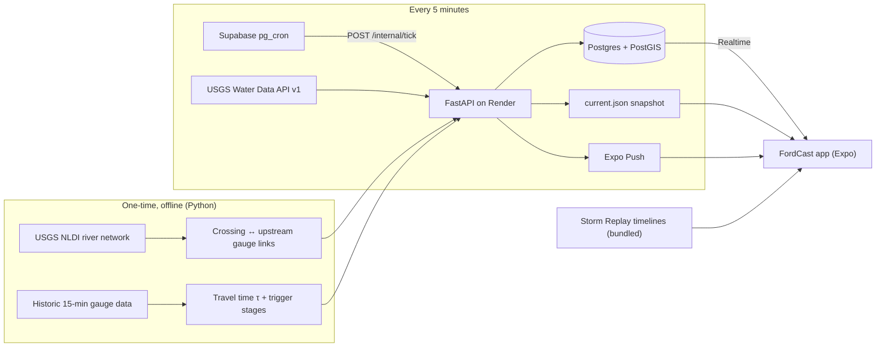

# PART E — Submission, integrity & operations (§38–§45 + Appendix: Sources)

> Addressed to the AI coding agent. Part E covers everything around the code that decides how judges see FordCast: the CAC rules, AI-use integrity, the README, the demo video, impact evidence, keeping services alive through judging, the Claims Ledger, and the final checklist.
>
> **Division of labor.**
> - **You (the agent):** draft, generate, verify and check.
> - **The student:** decides, writes the four core files, writes the answers, records the voice-over, sends every email, and presses Submit.
>
> **Stop-and-ask triggers (§1.7) that matter most here:**
> - Publishing anything: making the repo public, a GitHub Release, uploading the video, the submission form.
> - Contacting people.
> - Anything that costs money.
> - Any change to `docs/results/results.json` after the science freeze.

---

## §38. CAC compliance

### 38.1 Rules: known vs. must-verify

The research could not reach congressionalappchallenge.us or house.gov, so **every CAC rule below is UNVERIFIED** until the student reads the official pages. Treat each row as "VERIFY BEFORE USE".
- Record what the pages actually say in `submission/RULES_NOTES.md` (template in §38.3).
- If any rule differs from this prompt, it is a stop-and-ask (§1.7 item 13).

| # | Item | Current belief | Status | How to verify | Fallback if unverifiable |
|---|---|---|---|---|---|
| R1 | Deadline | **Mon Oct 26, 2026, 12:00 PM ET** (= 11:00 AM CDT) for offices on the national date. Some offices use other dates (e.g. Oct 30). | Example office page (larsen.house.gov, concept doc S11). Not re-fetched. | The student's own Representative's CAC page + congressionalappchallenge.us | **Submit Sun Oct 25** in every case |
| R2 | District / office | Travis County is split among TX-10/17/21/35/37 (concept doc S10). The TX-10 incumbent is not running in 2026, but the office serves until Jan 3, 2027. The 2025 Texas redistricting applies to the 2026 *election*, not to the current office. | UNVERIFIED | §38.2 steps | Treat TX-10 as a placeholder until confirmed |
| R3 | Eligibility | Middle- and high-school students who live in, or are eligible to attend school in, a participating district. Homeschool usually counts. | UNVERIFIED | CAC site → Students → Rules / FAQ | — |
| R4 | Team | Individual, or a team of up to 4 (mixed-district rules apply) | UNVERIFIED | Rules page | Solo entry (no issue) |
| R5 | Entries | One app per student per year; no app previously submitted to CAC | UNVERIFIED | Rules page | FordCast is new (first commit Oct 2026) |
| R6 | Platform | Any (mobile, web, desktop, game) | UNVERIFIED | Rules page | Android APK + source |
| R7 | Work window | Work done during the current competition cycle | UNVERIFIED | Rules page | The repo history starts Oct 2026. The README declares reused templates T1–T8 (§12.1). |
| R8 | What is submitted | Registration; app title and description; **demo video link** (YouTube/Vimeo); **code** (repo link or upload); written answers (concept doc Q1–Q4) | UNVERIFIED | Registration form preview | Prepare every field in `submission/` (§38.4) |
| R9 | Video length | Commonly "1–3 minutes" | UNVERIFIED | Rules / office page | **2:15–2:30; never over 3:00** |
| R10 | Video visibility | Public or unlisted; no login needed | UNVERIFIED | Rules page | Unlisted YouTube, tested logged-out (§41.10) |
| R11 | AI tools | Believed allowed with disclosure, as long as the student can explain the work | UNVERIFIED | Rules / FAQ. **Copy the exact text** into `AI_USE.md` §1. | Follow §39 in full either way |
| R12 | Parent/guardian | Minors may need guardian info at registration | UNVERIFIED | Registration form | Parent's email ready on Oct 25 |
| R13 | Judging | Each office recruits its own judges. Commonly cited criteria: (1) quality of the idea, (2) implementation, (3) demonstrated coding excellence. | UNVERIFIED | Rules / office page | Build to §38.5 |
| R14 | Recognition | District winners are announced by the Member (often Dec–Jan). Winners are invited to #HouseOfCode in DC in spring. | UNVERIFIED | CAC site | Keep the app runnable through spring 2027 (§43) |
| R15 | App-store publishing | Not required | UNVERIFIED | Rules page | **Do not publish to stores before judging** (§38.6) |

**Done when:** every row in `submission/RULES_NOTES.md` has a quote or "not stated", plus the URL and the date it was read. Any difference from this table has been raised with the human and resolved.

### 38.2 District and office verification (student, ~15 min, by Fri Oct 16)

1. **Find the district.** On house.gov "Find Your Representative", enter the **full home address**, not just the ZIP code. Travis County ZIPs can span several districts.
2. **Record the result.** Write the Representative's name and district number in `submission/RULES_NOTES.md`.
   - Keep any screenshot **outside the public repo**, because it shows the home address.
   - Commit only the district number and the date checked.
3. **Find the office's CAC page.** Search that Representative's house.gov site for "Congressional App Challenge 2026". Also check the participating-district list on congressionalappchallenge.us.
4. **Confirm participation in 2026.** If the page is missing or unclear, email the office (template below) by **Fri Oct 16**. In the meantime, keep building.
5. **Record the details:** the deadline, its time zone, the video-length guidance, the code-submission format, the AI rule, and any office-specific requirement.
6. **If the district is not TX-10:** update the district everywhere it appears: README, video title and end card, concept doc header, About screen, `submission/answers.md`.
   - No code changes are needed. FordCast's Travis County coverage serves every Austin-area district.
7. **If the school is in a different district than the home:** ask the office which one applies (R3). Don't guess.
8. **Ask the office (same email)** whether the Jan 3, 2027 change of Congress affects how winners are announced.

```text
Subject: Congressional App Challenge 2026: participation question from a student

Hello,
I'm [First Last], a 9th grader at [School] in [City]. I live in [district number, from house.gov].
I plan to submit an app to the 2026 Congressional App Challenge. Could you confirm:
1) that the office is participating this year,
2) the submission deadline and time zone, and
3) any office-specific rules (video length, code submission, use of AI coding tools)?
Thank you,
[Name] · cc: [Parent/Guardian]
```

**Done when:** the district is confirmed and the office's participation is confirmed in writing (an office page, the CAC list, or an email reply), and both are recorded with dates.

### 38.3 `submission/RULES_NOTES.md` template (agent creates; student fills)

```markdown
# CAC 2026 rules notes (read by: [student], [date])
| Rule | Exact text or "not stated" | URL | Date read |
|---|---|---|---|
| Deadline + time zone | | | |
| District confirmed (number only) | | house.gov Find Your Representative | |
| Office participating 2026 | | | |
| Eligibility | | | |
| Team rules | | | |
| One entry / prior entries | | | |
| Work window / originality | | | |
| Required fields (title, description, video, code, answers) | | | |
| Video length / host / visibility | | | |
| Code submission format (link vs upload) | | | |
| AI-tool policy (paste verbatim; also copied into AI_USE.md §1) | | | |
| Parent/guardian requirement | | | |
| Judging criteria | | | |
| Anything office-specific | | | |
```

### 38.4 Submission fields → source files → owner

| Form field (VERIFY exact names on the form) | Source in repo | Owner | Rule |
|---|---|---|---|
| App title | "FordCast" | — | Identical in app, README, video, form |
| Short description / purpose (Q1) | `submission/answers.md` Q1 | Student | One sentence. Matches README line 2 and the video. |
| Inspiration (Q2) | `submission/answers.md` Q2 | Student | Real personal details only |
| What the app accomplishes (Q3) | `submission/answers.md` Q3 | Student | Numbers only from `docs/results/results.json` |
| Technical difficulty (Q4) | `submission/answers.md` Q4 | Student | Uses the real `examples.nearest_gauge_story` and the student's own core-file experience (§39.9) |
| Video link | `submission/video/LINK.md` | Student uploads; agent checks | Unlisted, tested logged-out |
| Code link | `https://github.com/godtier812/Fordcast-CAC/tree/cac-2026-submission`, or the repo URL if tag links aren't accepted | Agent prepares; student pastes | Tag exists before pasting |
| AI disclosure (if the form has a field; otherwise one paragraph in the description) | `AI_USE.md` §2 summary | Student | §39.9 template |
| Platform / how to run | README "Try it" + Release APK link | Agent | APK link works logged-out |

### 38.5 Judging criteria → FordCast evidence (build to this)

| Criterion (UNVERIFIED wording) | What strong entries show | FordCast proof | Where it lives | Requirement |
|---|---|---|---|---|
| **Idea quality / impact** | A clear local problem, a new angle, a measurable result | Sourced stats (S1–S3). Per-crossing lead time vs. reactive tools. **Backtest median lead, POD, FAR** with CIs. Stakeholder feedback (only with permission). Comprehension-test result. | README top, video 0:00–0:35 and 0:35–1:20, Replay results screen (F80), Q1/Q3 | Every number generated by `make backtest` (§18.13). No hand-typed metrics. |
| **Implementation / UX** | Polished, working, accessible, fits the user | Night-first UI. A calm day that looks alive. Drive Mode. Spanish. TalkBack/VoiceOver. CVD-safe 4-way states. Offline Replay. Zero crashes. | Video 1:20–1:57, README screenshots, `docs/a11y/TESTING.md` | §7.6 release readiness; §34 matrix |
| **Coding excellence** | Real complexity, clean structure, tests, a student who can explain it | NLDI graph traversal; cross-correlation τ; a no-lookahead `DataSource` with **tests that fail on lookahead**; leave-one-storm-out; POD/FAR/CSI; CI badge; typed API; explain-back docs | `backend/fordcast/**`, `backend/tests/**`, `docs/explain/*.md`, CI | The four core files are student-owned (§39). CI is green on the tag. |
| (Implicit) Presentation and honesty | A video that hooks in 10 s; claims match the code | Claims Ledger; Built/Prototype/Roadmap labels everywhere; REPLAY banner; honesty line | `docs/CLAIMS.md`, About → What's built, README table | §44 gates every claim |

**Patterns of strong entries** (UNVERIFIED; general pattern, so browse the past-winners gallery on congressionalappchallenge.us to confirm):
- A local, personal problem in the first 10 s.
- A working app on a real device.
- One specific number.
- Real users or partners.
- Inclusion: accessibility and a second language.
- A clean, captioned video.
- A technical story the student can explain.

**FordCast's edge:** most entries are information apps. FordCast *forecasts*, then *proves it* with Storm Replay. **Lead every artifact (video, README top, Q1/Q3) with the replay proof.**

### 38.6 Distribution, stores and accounts

- **No public app-store release before judging ends.** This avoids store review, store age-verification duties, and COPPA/Texas-law exposure (not legal advice; a parent should review; privacy design in §24).
- **Android (all lanes):** the `preview` APK goes on a GitHub Release (with sha256) and the EAS internal-distribution link (§36.7). The README links both.
- **iOS:** only in Lane B. TestFlight **internal** testing under a parent's paid account, on request. Never submit to the public App Store.
- **Accounts:** Apple Developer and Google Play accounts generally require an adult holder (UNVERIFIED). Use a parent's account if one is ever needed.
- Publishing the GitHub Release, making the repo public, and uploading the video are stop-and-ask actions (§1.7 item 4). The agent prepares; the student and parent press the button.

### 38.7 `submission/CHECKLIST.md` (agent creates on Day 0; ticked on Oct 25)

```markdown
# CAC 2026 submission checklist — FordCast
## Rules & eligibility
- [ ] District confirmed with full home address (house.gov) — district #: ____ (date ____)
- [ ] Office participation 2026 confirmed (page / CAC list / email) — saved in submission/RULES_NOTES.md
- [ ] Rules page read today; deadline + time zone, video length, team, AI rule, code format recorded
- [ ] Registered on congressionalappchallenge.us (student + parent/guardian if required)
## Content
- [ ] Title "FordCast", tagline "Know before it crosses.", Q1 sentence identical in app, README, video, form
- [ ] Q1–Q4 written by the student in their own voice (submission/answers.md); agent did not write final text
- [ ] Every [X]/[N]/[m]/[POD]/[FAR] replaced from docs/results/results.json (CI hand-typed-metric check green)
- [ ] Claims Ledger (docs/CLAIMS.md): every claim used is Built/Prototype with evidence, or removed
- [ ] AI_USE.md complete: official AI rule pasted, per-file authorship table, disclosure paragraph used in the form
## Video
- [ ] 2:15–2:30 (≤ 3:00), 16:9 1080p, ≥ 60 % real app footage
- [ ] REPLAY label on all replay footage; "Live data · <date>" on live footage
- [ ] EN captions + ES subtitles uploaded; no strobe; music license recorded
- [ ] Unlisted (or as rules require); link tested logged-out on a phone and a laptop
## Code & app
- [ ] Public repo; README top has video link + APK link + live status
- [ ] Tag cac-2026-submission on the submitted commit; GitHub Release with APK + sha256 + results.json
- [ ] CI green on the tagged commit
- [ ] No secrets in repo or history (scan run on ____)
- [ ] Safety disclaimer in app (pledge + footer) and README; attributions in About, README, video end card
- [ ] Calm-day QA done today: complete, alive, no banned words, Unknown handling visible, no crashes
- [ ] Airplane-mode QA: Storm Replay plays to the result screen
## Operations
- [ ] Render Starter active; healthchecks + UptimeRobot green; GH watchdog enabled (§43)
- [ ] Commit calendar set: Nov 10, Nov 30, Dec 15, Jan 4
## Submit
- [ ] Submitted on Sun Oct 25 (time: ____ CT)
- [ ] Confirmation email saved as PDF in submission/ (personal details redacted in the public copy)
```

**Done when (§38):** `RULES_NOTES.md` is filled and `CHECKLIST.md` is fully ticked on Oct 25. Every submission field maps to a committed file.

---

## §39. AI-use integrity & explain-back protocol

### 39.1 Why this section exists

An AI agent builds most of FordCast. That creates two risks:
1. **Rules risk.** CAC's AI rule is unverified (R11).
2. **Q&A risk.** Judges score the *student's* coding, and finalists are questioned in person.

The mitigation is **disclosure + ownership + explanation + an audit trail**:
- The student personally writes or co-writes the four files that carry the core science.
- The student can explain every line of them.
- Everything else is honestly labeled as AI-assisted.

### 39.2 Rules (MUST)

1. **Disclose.** Maintain `AI_USE.md` (§39.5) from Day 0. Use its §2 summary paragraph in the CAC form (description, or an AI field if one exists).
2. **The student owns the core.** The four files in §39.3 follow the pause protocol in §39.4. Never silently fill in a `TODO(student)` body.
3. **Explain-back docs.** Write `docs/explain/<module>.md` (§39.6) for each core file *before* the student starts. Write a shorter one for every other major module (§39.7).
4. **Honest commits.**
   - Agent commits carry the harness's co-author trailer.
   - Student commits come from the student's own git identity, with no trailer.
   - Small commits, across days. Never squash, rebase published history, or force-push before judging ends (§1.4).
5. **No fabricated numbers.** Every number in the video, README, answers and app comes from `docs/results/results.json` (§18.13). Until a number exists, leave the placeholder (`[X]`, `[N]`, `[m]`, `[POD]`, `[FAR]`).
6. **Answers in the student's voice.**
   - You MAY propose an outline and point to facts and files.
   - You MUST NOT write the final Q2–Q4 text or the voice-over in the student's voice.
   - You MAY spell-check and fact-check the student's draft against `results.json`.
7. **No AI voice, face or generated footage in the demo video.**
   - The voice-over is the student's own voice.
   - B-roll is the student's own safe footage or licensed stock (§41.9).
   - Spanish subtitles drafted with AI must be reviewed by the native speaker (§35) and disclosed in `AI_USE.md`.

### 39.3 The four student-owned core files

| # | File (canonical, §5) | Contract (owned by §18/§19) | Tests the agent writes first | Explain-back doc | Pause day |
|---|---|---|---|---|---|
| 1 | `backend/fordcast/linking/travel_time.py` | `estimate_lag(up, down, storm_id, *, step_min=5, max_lag_min=240, min_r=0.5) -> LagEstimate \| None`; `combine_storms(estimates, channel_dist_km) -> LinkLag \| None` (§18.3) | `tests/unit/test_travel_time.py`: synthetic lags 35/40/45/40 recovered within ±1 min; noise-only → `None`; constant → `None`; 240-min boundary not refined out of range; median/IQR on hand values; celerity outside [0.5, 6] m/s → `needs_review` | `docs/explain/travel_time.md` | Day 3 (Sat Oct 17) |
| 2 | `backend/fordcast/model/baseline_rule.py` | `evaluate(crossing, links, series, as_of) -> RuleResult` (§18.5) | `tests/unit/test_baseline_rule.py`: every row of the §18.5 logic table; stale links ignored; window buckets; reasons emitted; `eta_lo ≥ 0` | `docs/explain/baseline_rule.md` | Day 4 (Sun Oct 18) |
| 3 | `backend/fordcast/scoring/metrics.py` | `episodes_from_frames`, `match_events`, `scores`, `bootstrap_ci` (§18.12) | `tests/unit/test_metrics.py`: H=1/M=1/F=1 case; alert at onset = lead 0; 181 min early → not a hit unless still active (capped); two episodes before one onset; ÷0 → NaN; bootstrap deterministic with `seed=0` | `docs/explain/metrics.md` | Day 4 (Sun Oct 18) |
| 4 | `backend/fordcast/sources/base.py` | `visible(...)`, `assert_no_lookahead(...)` bodies (types and docstrings are the agent's skeleton, §19.1) | `tests/test_no_lookahead.py`: prefix invariance, future poison, latency respected, source rejects lookahead; `tests/test_truth_isolation.py` | `docs/explain/datasource.md` | Day 5 (Mon Oct 19) |

If the tests were committed at slightly different paths, use those and update this table in `AI_USE.md`.

### 39.4 Pause / hand-off protocol (exact sequence)

Use the student's Step 0 answer (Q12: write it themselves with hints, or co-write) and their hours per day to set the timebox.

**A. Before the pause** (agent, in this order, as separate commits):
1. `test(<scope>): failing tests for <file>`. The tests must fail for the right reason (`NotImplementedError`), not on import errors.
2. `feat(<scope>): skeleton for <file> (student TODOs)`. Typed signatures, docstrings, `# TODO(student): …` markers, no logic.
3. `docs(explain): <module> explain-back`. The doc from §39.6, with the three questions left unanswered.
4. Update `AI_USE.md` row → status "awaiting student".

**B. The hand-off message** (post it verbatim, filled in, then stop working on that file):

```text
STUDENT TASK #<n> — backend/fordcast/<path>.py
Why it matters: <one sentence from the explain-back doc>
1) Read docs/explain/<module>.md (about 15 min). Don't answer the questions yet.
2) Implement every TODO(student) in <path>.py. Contract and examples are in the docstrings.
3) Run:  cd backend && uv run pytest <test path> -q      (now: <k> failing)
4) Commit from YOUR git identity:  git commit -m "feat(<scope>): implement <thing>"
5) Answer the 3 questions at the bottom of the explain-back doc in your own words; commit.
6) Tell me "review <module>".
Timebox: ~<90> min. Stuck? Say "hint 1", "hint 2" or "hint 3" (see the hint ladder).
While you work I'll continue on: <other track tasks>.
```

**C. Hint ladder** (give only the level asked for; log each hint given in the explain doc's "Hints used" list):

| Level | What you give | Example (travel_time) |
|---|---|---|
| hint 1 — concept | Restate the goal and the idea in plain words | "You're sliding one wiggly line along the other and looking for the shift where they match best." |
| hint 2 — steps | Pseudo-code for the step they're on, in comments, no Python | "for each lag k: take up[:n−k] and down[k:], compute their correlation, keep the best k" |
| hint 3 — pointer | Point at the failing line or test, and name the library function | "`np.corrcoef(a, b)[0, 1]`; check slice lengths when k = 0" |
| hint 4 — code | **Only if the human explicitly approves** (time-forced). You write the specific function; the authorship mode changes (below). | — |

**D. Review** (agent, after "review <module>"):
1. Run the file's tests, `uv run ruff check`, and the full `pytest -m "not live"`.
2. Read the diff line by line. Leave review comments in the chat: correctness, edge cases, naming, comments. **Do not edit the student's file yourself.** The student applies the fixes and commits.
3. Ask two "what if" questions out loud, e.g. "What happens if the upstream gauge has a 30-minute gap?" Record the student's answers in the explain doc under "Review Q&A".
4. Check that the student's three explain-back answers are in their own words. They must be correct or corrected after discussion.
5. Update `AI_USE.md` (authorship mode, commit SHAs) and `docs/CLAIMS.md` if a claim depends on this file.

**E. Authorship modes** (exactly one per file, recorded in `AI_USE.md`):

| Mode | Meaning | When |
|---|---|---|
| `student-written` | The student wrote all logic. The agent provided tests, skeleton, docs and hints ≤ 3. | Default goal |
| `co-written` | Agent skeleton + tests; student implementation, with hint 4 used for at most one function | Normal |
| `agent-written, student-annotated` | The agent wrote the logic. The student rewrote every docstring and inline comment in their own words, answered the 3 questions, and passed the review Q&A. | **Only** by explicit human decision (stop-and-ask), e.g. if the file isn't passing by the end of its pause day + ½ day |

**F. Timebox escalation.** If tests are still failing at the end of the pause day plus half a day, stop and ask with these options:
- (a) cut a Stretch item (§6.3) to give the student more time,
- (b) a live pairing session where the student types,
- (c) switch to `agent-written, student-annotated`.

Never pick (c) yourself.

### 39.5 `AI_USE.md` template (repo root; agent creates Day 0, keeps it current)

```markdown
# AI use disclosure — FordCast (CAC 2026)

## 1. Official CAC rule on AI tools
> [Paste the exact text from the CAC rules page here.]
Source: [URL] · read on [date] by [student]. (Until pasted: "Rule not yet read — UNVERIFIED".)

## 2. Summary (this paragraph is also used in the CAC form)
I built FordCast with help from an AI coding assistant (Claude Code, Anthropic) in October 2026.
The assistant generated most of the app scaffolding, user-interface components, backend plumbing,
tests and documentation drafts, following design decisions I made and reviewed. I personally
[wrote | co-wrote] the four files that hold the core science — travel-time cross-correlation,
the baseline forecast rule, the backtest metrics, and the no-lookahead data interface — and I can
explain every line of them. Every number I report comes from a script in the repository
(`make backtest`), not from the AI. My written answers and video narration are my own words.

## 3. Tools
| Tool | Version / model | Dates | Used for |
|---|---|---|---|
| Claude Code (Anthropic) | [model shown in session] | Oct 14–25, 2026 | scaffolding, UI, backend, tests, docs drafts, reviews |
| [any other, e.g. a translation aid] | | | [e.g. first-draft Spanish strings, reviewed by ___] |

## 4. What I (the student) did
- Problem choice, crossings/storms of interest, and design decisions (Step 0 answers: docs/decisions/step0.md)
- Wrote/co-wrote the core files (table below); answered the explain-back questions (docs/explain/)
- Checked the crossing-to-gauge links on a map (notebooks/01_inventory_and_snaps.ipynb)
- Ran the device tests, the comprehension test, the outreach; recorded the video; wrote Q1–Q4

## 5. Per-file authorship
| File | Mode | Student commits | Hints used | Explain-back |
|---|---|---|---|---|
| backend/fordcast/linking/travel_time.py | [student-written / co-written / agent-written, student-annotated] | [SHAs] | [1,2] | docs/explain/travel_time.md |
| backend/fordcast/model/baseline_rule.py | | | | docs/explain/baseline_rule.md |
| backend/fordcast/scoring/metrics.py | | | | docs/explain/metrics.md |
| backend/fordcast/sources/base.py | | | | docs/explain/datasource.md |
| Everything else | AI-generated, reviewed by me and checked by tests/CI | — | — | docs/explain/overview.md |

## 6. How AI output was checked
Unit/contract/no-lookahead tests (pytest, Jest), CI on every push, device tests on a real phone
(docs/a11y/TESTING.md, docs/devlog.md), banned-words and i18n parity tests, golden replay hashes,
human review of the core files, native-speaker review of Spanish.

## 7. Reused templates and third-party code (not written by me or the AI)
Expo default template (0BSD) · React Native Reusables (MIT) · gorhom bottom-sheet map example (MIT) ·
Expo examples (MIT) · OpenFreeMap Positron style · Inter (OFL-1.1) · [Lottie assets, if used].
Full list: THIRD_PARTY_NOTICES.md.

## 8. What the AI did not do
It did not invent data, numbers, quotes or test results; it did not send emails or contact anyone;
it did not write my final answers or narrate the video.

## 9. How to audit
git log --format='%h %ad %an %s' --date=short -- backend/fordcast/linking/travel_time.py
git log --grep='Co-Authored-By' --oneline | wc -l     # agent-assisted commits
git shortlog -sn                                       # commits per author
```

### 39.6 Explain-back doc template (`docs/explain/<module>.md`, 9th-grade reading level)

```markdown
# <Module name> — explained
**File:** backend/fordcast/<path>.py · **Owner:** [student] ([mode]) · **Tests:** <test path>

## What it does (2–3 sentences, no jargon)
## Why FordCast needs it (one real example from our data)
## Picture
<one ASCII or Mermaid diagram>
## Step by step (matches the code, with line numbers)
1. … (L12–L20)
## Worked example (small numbers you can check by hand)
## The tests and what each one catches
| Test | What bug it would catch |
## Common mistakes
## Words to know
| Word | Plain meaning |
## Questions for me (answer in my own words)
1. <question>  — **My answer (date):**
2. …
3. …
## Hints used
## Review Q&A (filled after the agent's review)
## If a judge asks… (2–3 likely follow-ups, with my short answers)
```

**Required questions** (from §18 and §19; do not change them without asking):

| Doc | Questions |
|---|---|
| `travel_time.md` | Why correlate the *rate of rise* instead of the water level? What problem does the parabola step fix? Why use the median across storms instead of the mean? |
| `baseline_rule.md` | Why must the gauge be *rising*, not just high? Why do we show the window that starts at the *earliest* arrival? What happens when the upstream gauge stops reporting? |
| `metrics.md` | Why is a false alarm as important as a miss for a warning app? Why do we resample whole storms in the bootstrap instead of single readings? What does a CSI of 0.5 mean in plain words? |
| `datasource.md` | What is the difference between `obs_time` and `available_at`, and why does it change our lead-time number? Why does the same `tick()` work for live and replay? What would the prefix-invariance test catch if `visible()` had a bug? |

### 39.7 Other explain docs (agent-written; shorter: what, why, picture, 1 question)

Write these:
- `overview.md` (the whole system in one page; read on Day 1)
- `nldi_linking.md`
- `triggers.md`
- `state_machine.md`
- `windows.md`
- `tick.md` (the one pipeline)
- `replay_build.md`
- `snapshot_and_realtime.md`
- `push.md`
- `map.md`
- `replay_player.md`
- `drive_mode.md`
- `i18n_and_a11y.md`
- `ml.md` (only if F15 exists)

Each one links to its § in this prompt and to the code.

### 39.8 Finalist and judge Q&A prep

Practice plan:
- Two 15-minute mock interviews (a parent or teacher plus the agent's question list): one before Oct 25 and one in mid-November.
- The student also reads each core file aloud, one line at a time, once before each mock.

Answers must use the real numbers and files.

| # | Likely question | Answer outline (student fills in real details) | Point to |
|---|---|---|---|
| 1 | Walk me through what happens every 5 minutes. | Clock (pg_cron) → tick → fetch USGS → features → rule → state machine → write on change → snapshot → push | `fordcast/tick.py`, §20.3 |
| 2 | How do you know which gauge is upstream of a crossing? | NLDI snaps the crossing to its river reach, then navigates upstream tributaries to gauges. I checked every snap on a map and fixed mis-snaps by hand. | `linking/nldi.py`, notebook 01 |
| 3 | Why not just use the nearest gauge? | It's often on a different creek. Give the real `examples.nearest_gauge_story`. | `docs/results/results.md` |
| 4 | How did you compute travel time? | Rate of rise, smoothed; slide one series along the other; best correlation; parabola refinement; median across storms | `travel_time.py`, explain doc |
| 5 | How do you know the replay isn't cheating? | `available_at` plus two tests: prefix invariance and future poison. They fail if any future reading leaks. | `sources/base.py`, `tests/test_no_lookahead.py` |
| 6 | How accurate is it? | POD, FAR, CSI and median lead with 95 % CIs over [n] storms. Few storms means wide intervals; say so. | `results.json` |
| 7 | What's a false alarm, and why care? | People stop listening ("cry wolf"). FAR is a headline metric. Hysteresis prevents flapping. | `metrics.py`, `state_machine.py` |
| 8 | Did you use machine learning? | Either "the ML prototype did / didn't beat the rule in leave-one-storm-out, by …" or "No: a forecast rule learned from past storms, and here's why that's honest" | `results.json.methods` |
| 9 | What if a gauge stops reporting? | UNKNOWN, never calm. The 2013 Onion Creek gauge went silent at the peak. | Replay `halloween-2013` |
| 10 | Why does the app never say "safe"? | False reassurance raises risk. Show the comprehension-test result (0/8 read the calm state as safe, if true). | §3, §42 |
| 11 | What if FordCast is wrong? | It's supplementary: official closures override it, there's a pledge and a footer, and it can be late. | §3.9 |
| 12 | What does a judge see on a dry day? | The honest calm state plus Storm Replay | Calm-day screenshot |
| 13 | How do alerts work without tracking people? | The phone works out which crossings it cares about; the server only knows crossing IDs and a push token. | `push/`, PRIVACY.md |
| 14 | How is it accessible? | Shape + glyph + word + color; TalkBack/VoiceOver tested; large text; CVD renders | `docs/a11y/TESTING.md` |
| 15 | Who checked the Spanish? | Name the reviewer (with permission). usted, es-US. Spoken alerts. | §35, README |
| 16 | How much did AI write? Which parts did you write? | `AI_USE.md` table. Offer to explain any core-file line. | `AI_USE.md` |
| 17 | "Explain this line." (judge points at a core file) | Practice by reading each core file aloud | the 4 files |
| 18 | What was the hardest bug? | A real devlog entry | `docs/devlog.md` |
| 19 | How does data delay affect lead time? | Satellite gauges report about hourly; the replay models it; show the delay-sensitivity table | `results.json.delay_sensitivity` |
| 20 | Could this work outside Austin? | USGS gauges and NHDPlus cover the U.S.; tiers B/C; HAND overtop stages are Roadmap | §17, §18 |
| 21 | What would you do next? | Radar rainfall (if not built), official agency feeds, moderated crowd reports | README Roadmap |
| 22 | How much does it cost to run? | About $17–21 for Render Starter Oct 20 → Dec 31; the rest is free tiers | §20.10 |
| 23 | Why Python/FastAPI, Supabase, Expo? | Skills match; async I/O; PostGIS + Realtime; one codebase for both phones | §20, §25 |
| 24 | How did you test it? | pytest, Jest/RNTL, Maestro, device matrix, airplane-mode test, 8-person comprehension test | CI badge, docs |

### 39.9 Honest wording for the written answers (and the README/video)

**Say / don't say:**

| Say | Don't say |
|---|---|
| "a forecast rule learned from past storms" (unless the ML ledger row C12 is Built) | "AI-powered", "machine learning predicts…" |
| "In replays of [n] real storms, the median warning came [m] minutes before water reached the road" | "FordCast predicts floods 40 minutes early" (unqualified) |
| "My best example was [X] minutes; the median was [m]" | the best example alone |
| "supplementary flood-risk information" | "emergency alert system", "keeps you safe", "saves lives" |
| "designed to follow NHTSA's visual-manual distraction guidelines" | "NHTSA-compliant" |
| "I'm not aware of a published system that forecasts low-water-crossing flooding per crossing from upstream gauges" | "the first ever" |
| "live USGS data, updated every 5 minutes (gauges can lag 15–60 min)" | "real-time" without qualification |
| "push alerts on Android" (if only Android was tested) | "alerts on every phone" |
| "Storm Replay works offline" | "the whole app works offline" (unless C18 is Built) |
| "I contacted the City of Austin's flood-safety office" | "partnered with the City", "endorsed by" |
| "built with an AI coding assistant; I wrote [the core files]" | hiding or minimizing AI use |

**Q-by-Q guidance** (outline only; the student writes the text):
- **Q1:** keep the concept-doc sentence. It already avoids "safe".
- **Q2:** one real memory (a crossing, a school route, July 2025). No borrowed stories.
- **Q3:** problem → what FordCast does → the replay proof with real numbers → the safety principle → the Spanish gap → next steps. Numbers come only from `results.json.headline` and `hero`.
- **Q4:** the real nearest-gauge story (`examples.nearest_gauge_story`) → NLDI + travel time → the no-lookahead lesson. Mention one difficulty the student personally hit in a core file. The lesson is in the student's words.
- **CI check:** `submission/answers.md` passes the hand-typed-metric check (§18.13, §24.7) before submission.

**Done when (§39):**
- All four core files have an authorship mode recorded, student commits, answered explain-back questions, and review Q&A.
- `AI_USE.md` §1 holds the official rule text, or is flagged UNVERIFIED with the human's acknowledgment.
- The Q&A list has been practiced once before Oct 25.

---

## §40. README & repo hygiene

### 40.1 Principles

- **Judge-first.** A judge who reads only the first screen should know four things: what FordCast does, that it works, the one number, and how to try it.
- **Generated, not typed.** The Results table and the Built/Prototype/Roadmap table are spliced between markers by `make claims`. That command runs `tools/gen_claims.py`, which:
  - writes `claims.generated.json`;
  - renders the README claims table from `docs/CLAIMS.md`;
  - renders the results table from `docs/results/results.json`.
- **CI check:** run `make claims && git diff --exit-code README.md mobile/src/features/about/claims.generated.json`. CI fails if the README is stale.

### 40.2 README outline (create on Day 0 as a skeleton; fill as features land)

````markdown
<p align="center"></p>
<h1 align="center">FordCast</h1>
<p align="center"><b>Know before it crosses.</b><br>
FordCast warns Central Texas drivers which low-water crossings are likely to flood soon — before water reaches the road — and helps them take another route.</p>
<p align="center">[CI badge] [License: MIT] [Platform: Android (tested) · iOS (status)]</p>

<p align="center"></p>

**[Watch the 2-minute demo video](VIDEO_URL)** · **[Download the Android APK (GitHub Release)](RELEASE_URL)** · iOS: [TestFlight on request | not tested] · Live backend: [status](docs/status.md)

> FordCast is a supplementary tool. Obey barricades and official warnings. Never drive into water.

## The problem
3 facts with footnotes [S1]–[S3]; one line on the gap (tools report closures after water is on the road).

## What FordCast does
- Links each crossing to the stream gauges truly upstream of it (USGS river network)
- Learns from past storms how long floodwater takes to arrive
- Watches those gauges live and marks the crossing Watch → Avoid with a time range, a reason and a detour
State ladder image: docs/media/state-ladder.png (○ No rise detected · ▲ Watch · ⯃ Avoid · striped ⯃ Flooded – Closed · ◌ Unknown – data offline)

## Results (replayed real storms)
<!-- results:start (generated by make claims from docs/results/results.json — do not edit) -->
| Storm | Crossings | POD | FAR | CSI | Median lead (IQR) |
| … | … | … | … | … | … |
Pooled, leave-one-storm-out, 95 % bootstrap CIs; comparators: reactive (0 min), nearest gauge, upstream rule[, ML].
<!-- results:end -->
How we scored this: 5 bullets — events after hysteresis; hit window 180 min; leave-one-storm-out;
no-lookahead tests; data-delay assumption [d] min (sensitivity table in docs/results/results.md).
Reproduce: `make backtest`.

## What's built (Built · Prototype · Roadmap)
<!-- claims:start (generated from docs/CLAIMS.md) -->
<!-- claims:end -->

## How it works

6 numbered steps in plain English, each linking to the file that does it.

## Screenshots
EN and ES side by side · Crossing detail (Avoid) · Drive Mode · TalkBack focus · calm day.

## Safety design
Never-safe principle · the 5 states · ranges not countdowns · official closures override · stale → Unknown · alert policy (escalation-only, caps, hysteresis) · the pledge and the disclaimers (link §3 copy).

## Accessibility
Features list · test table (device · OS · setting · result · date) from docs/a11y/TESTING.md ·
CVD 4-up image: docs/a11y/cvd/<screen>-4up.png (protanopia · deuteranopia · tritanopia · grayscale; tools/cvd_screens.py).
Claim sentence only if §34 matrix passes (C27).

## Español
One paragraph in Spanish: what FordCast does, that it never calls a crossing safe, reviewer credit.

## Tested with people
Comprehension/usability test summary from submission/comprehension-test/results.md (real n, task success, SUS,
how many read the calm state as "safe"), plus outreach replies quoted only with permission (§42).

## Privacy
No accounts, analytics or ads · location stays on the phone · the server knows only crossing IDs + a push token · "Delete my alert data" · links: PRIVACY.md · PRIVACY.es.md.

## Data sources and attribution
Table from §40.6 (source · what we use · license · attribution).

## Run it yourself
### Try the app (no keys)
Install the APK from Releases → Replay tab → works in airplane mode.
### Backend
```bash
git clone https://github.com/godtier812/Fordcast-CAC && cd Fordcast-CAC
make setup                      # uv sync (backend) + npm ci (mobile)
make test                       # ruff + pytest (not live) + jest
make backtest                   # reproduces docs/results/results.json
# storm Parquet files not in git: fetch from the public Storage mirror (sha256 checked against data/MANIFEST.json, §19)
# or rebuild: cd backend && uv run python -m fordcast backfill --storm <id>   (needs a free USGS API key)
cp backend/.env.example backend/.env   # USGS_API_KEY, DATABASE_URL, … (see file)
make api                        # FastAPI on http://localhost:8000/docs
```
### Mobile
```bash
cd mobile && cp .env.example .env      # EXPO_PUBLIC_SUPABASE_URL / _KEY / EXPO_PUBLIC_API_BASE
npx expo run:android                   # local development build (Android Studio), or:
npx eas-cli@latest build -p android --profile development
npx expo start --dev-client
```

## Repo map
One line per top-level folder (§5).

## Testing
Unit, contract, no-lookahead (prefix invariance, future poison), truth isolation, golden replay hashes, banned-words and i18n parity, RNTL role tests, Maestro flows, device a11y matrix.

## AI use
3-sentence summary (AI_USE.md §2) + link to AI_USE.md and docs/explain/.

## What I learned
Student-written.

## Acknowledgments
Testers (first names or "8 volunteer testers"), Spanish reviewer, agencies that replied (permission only), template authors (THIRD_PARTY_NOTICES.md).

## License
Code: MIT (LICENSE). Data: each source's terms (see table). Docs and images: CC BY 4.0 (if chosen).
````

**Rules for the README:**
- Total length ≤ ~600 lines.
- Every image has alt text.
- Every claim matches `docs/CLAIMS.md`.
- No hand-typed metric.
- No banned words used as reassurance (negations like "never says safe" are fine).
- Links are relative so they work on the tag.

### 40.3 README media production

- **Hero GIF** (≤ 8 MB, ≤ 10 s, 15 fps, 360 px wide, no flashing faster than 3/s). Record a replay take with scrcpy (§41.2), then:

```bash
ffmpeg -ss 00:00:05 -t 8 -i takes/replay-hero.mp4 \
  -vf "fps=15,scale=360:-1:flags=lanczos,split[a][b];[a]palettegen[p];[b][p]paletteuse" \
  -loop 0 docs/media/hero-replay.gif
```
(VERIFY BEFORE USE: `ffmpeg` is installed. Fallback: export the GIF from DaVinci Resolve.)

- **Screenshots:** `adb exec-out screencap -p > docs/a11y/screenshots/<screen>-<lang>.png` on the preview APK, with DEMO_MODE off. Name them `<screen>-<lang>-<theme>[-ax].png`.
- **CVD 4-up:** `uv run --group tools python -I tools/cvd_screens.py docs/a11y/screenshots docs/a11y/cvd` (§34.5).
- **State ladder image:** render the five `StatusGlyph`s with their words from the dev gallery, export a screenshot, crop it, and save it to `docs/media/state-ladder.png`.
- `docs/media/` holds README images only. Keep the total under 20 MB.

### 40.4 Commit conventions

- **Format:** Conventional Commits, `type(scope): imperative summary` (≤ 72 chars). Add a body when the *why* isn't obvious.
- **Types:** `feat fix test docs refactor perf ci chore build`.
- **Scopes** match folders and features: `mobile`, `mobile/map`, `mobile/replay`, `mobile/drive`, `mobile/a11y`, `mobile/i18n`, `backend`, `sources`, `linking`, `features`, `model`, `scoring`, `replay`, `push`, `api`, `supabase`, `data`, `tools`, `ci`, `docs`, `explain`, `submission`.
- **Examples:**
  - `feat(replay): add no-lookahead guard + future-poison test`
  - `test(linking): failing tests for travel-time cross-correlation`
  - `feat(linking): implement travel-time cross-correlation` (student identity)
  - `docs(explain): metrics explain-back`
  - `fix(mobile/map): keep max-rank cluster color`
  - `docs(status): refresh live metrics (judging-window commit)`
- **Agent commits** end with the co-author trailer lines the harness requires. **Student commits** have none.
- Branches `dayNN/<topic>` merged with **merge commits**, or small green commits directly to `main`, as decided in Step 0 Q13. **Never squash, rebase published history, or force-push** before judging ends.
- Commit at least several times a day during the build, and at least every 3 weeks after it (§43).

### 40.5 Tag, release and the submitted snapshot

1. On Oct 25, after §45 passes, tag the release commit (the same commit the APK was built from):
   ```bash
   git tag -a cac-2026-submission -m "FordCast — Congressional App Challenge 2026 submission"
   git push origin cac-2026-submission
   ```
2. Publish the GitHub Release (stop-and-ask, §36.7) with the APK, its sha256 and `results.json`. Link the release from the README.
3. **Never move or delete a pushed tag after the form is submitted.**
   - Before submission, if a fix is needed, re-tag only after asking the human.
   - After submission, fixes get new tags (`cac-2026-post-1`, …) and a CHANGELOG entry under "After submission".
4. The code link in the form points to `/tree/cac-2026-submission` if the form accepts it (UNVERIFIED, R8). Otherwise it points to the repo root, and `main` stays stable.

### 40.6 License, notices and attribution

- **`LICENSE`:** MIT, "Copyright (c) 2026 [STUDENT NAME]". This covers the code only.
- **`THIRD_PARTY_NOTICES.md`:** templates T1–T8 (§12.1), every npm and PyPI dependency's license, Inter (OFL-1.1), Lottie assets and creators (if used). Keep the MIT headers in the imported gorhom example files.
- **Data:** stays under each source's terms. Add `data/README.md`:
  - It lists each file's source.
  - Rows derived from OpenStreetMap (`source='osm'` in `crossings.geojson`) are © OpenStreetMap contributors, ODbL 1.0. Note the share-alike obligation for the derived crossings file (VERIFY BEFORE USE against the OSMF/ODbL guidance; fallback: publish the OSM-derived rows as a separate file under ODbL).
- **Docs and images:** CC BY 4.0 is optional. If chosen, state it in the README License section.

**Attribution matrix** (wording owned by §16.16 and §3.9; every listed place MUST show it):

| Source | Text | Map button | About → Sources | README | Video end card | Other |
|---|---|---|---|---|---|---|
| OpenStreetMap | "© OpenStreetMap contributors" | yes (MapLibre `attribution` on) | yes | yes | yes | Check My Drive footer |
| OpenFreeMap / OpenMapTiles | "OpenFreeMap © OpenMapTiles" | yes | yes | yes | yes (OFM README: video and print must show it) | — |
| USGS | "Data: U.S. Geological Survey, Water Data for the Nation (provisional, subject to revision)" | — | yes | yes | yes | gauge cards ("provisional") |
| NOAA / NWS | "Source: NOAA/NWS" | — | yes | yes | yes | NWS banner (F17) |
| City of Austin | "Source: City of Austin Open Data Portal" | — | yes | yes | yes | — |
| ATXfloods | "Official status: ATXfloods (City of Austin)" | — | yes (only if permission) | yes | if shown | official status row |
| openrouteservice | "Routing © openrouteservice.org by HeiGIT" | — | yes | yes | if routing shown | Check My Drive footer |
| Stadia / Photon / Open-Meteo / MRMS / LCRA | per §16.16 | — | if used | if used | if shown | — |
| Inter, templates, Lottie | per THIRD_PARTY_NOTICES.md | — | Credits & licenses | yes | — | — |

**Logos:** never show NWS, USGS, City or County logos, or the "Turn Around Don't Drown" logo, in a way that implies endorsement. Use attribution text only (§41.9).

### 40.7 Repo hygiene checklist

- [ ] Root files exist: `README.md`, `AI_USE.md`, `LICENSE`, `THIRD_PARTY_NOTICES.md`, `PRIVACY.md`, `PRIVACY.es.md`, `CHANGELOG.md`, `AGENTS.md`, `CLAUDE.md`, `Makefile`, `.env.example` files.
- [ ] `.gitignore` covers `.env*` (except examples), `node_modules`, `.expo`, `android/`, `ios/`, `*.apk`, `.venv`, `__pycache__`, large data, and `takes/` (raw video).
- [ ] Secret scan of the full history (§1.9 item 5) is clean. GitHub secret scanning and push protection are on (VERIFY BEFORE USE: availability in Settings → Code security).
- [ ] Notebooks have outputs cleared except small figures. Key figures are exported to `docs/results/figures/`.
- [ ] `mobile/example/` (from `reset-project`) is deleted before the tag (§12.2).
- [ ] GitHub repo "About" has the one-sentence description, topics (`flood`, `texas`, `expo`, `fastapi`, `congressional-app-challenge`), and the video link.
- [ ] Milestones MVP / Stretch / Roadmap exist. Roadmap items are open issues labeled `roadmap`.
- [ ] `docs/status.md` shows the live-service status and the last check date (§43).
- [ ] `CHANGELOG.md` has an "After submission" section from Oct 26.
- [ ] CI badge is green on the tag. No `TODO(student)` remains in the four core files.

**Done when (§40):**
- The README renders on GitHub with working relative links and the Mermaid diagram.
- The generated blocks match `results.json` and `CLAIMS.md`, and the CI diff check is green.
- The tag and the Release exist.
- The attribution matrix is satisfied everywhere.

---

## §41. Demo video production

### 41.1 Specs

| Item | Choice | Note |
|---|---|---|
| Length | **2:15–2:30**, hard cap 3:00 | R9 is UNVERIFIED; confirm with the office |
| Format | **16:9, 1920×1080** delivery; edit on a 4K timeline for crisp punch-ins; 30 fps (60 if UI motion stutters) | Judges likely watch on laptops (UNVERIFIED). Phone footage sits in a device frame with text beside it. |
| Real app footage | **≥ 60 % of runtime** (computed in §41.4) | Concept doc rule |
| Voice | The student's own voice-over, recorded in a quiet room with a phone or USB mic; no AI voice | §39.2 rule 7 |
| Captions | Hand-corrected **EN SRT** + **ES SRT**. Burned-in text only for kinetic stats. | §41.7 |
| Audio mix | VO first; music ducked well under it; target about −14 LUFS integrated, peaks ≤ −1 dBTP (UNVERIFIED YouTube normalization) | — |
| Photosensitivity | Nothing flashes more than 3×/s: no strobe or lightning b-roll | WCAG 2.3.1 applies to video too |
| Honesty labels | A permanent "REPLAY · real data from {storm} · not live" on all replay footage; "Live data · {date}" on live footage; "Simulated for demo" on any simulated shot | Claims Ledger §44 |
| Export | H.264 MP4, 1920×1080, AAC 48 kHz; plus a 4K ProRes/DNxHR master backup kept off-repo | Bitrate: Resolve "YouTube 1080p" preset (VERIFY) |

### 41.2 Capture setup

**Agent prepares:**
- A `demo` EAS profile or local run with `EXPO_PUBLIC_DEMO_MODE=1` (F83, §33.9). It provides deterministic replay start, hidden dev overlays, `DemoTouchOverlay` on iOS, and optional auto-slow to **10×** around key events (10×, not 4×: 4× isn't a speed preset; see §33.9).
- The build check MUST prove DEMO_MODE is off in `preview`/`production`.
- A capture checklist in `submission/video/shotlist.md`.

**Android (all lanes):**
```bash
# phone: full battery, charging, Do Not Disturb on, notifications cleared, brightness ~70 %, language as needed
scrcpy --show-touches --stay-awake --no-audio --record=takes/replay-hero-01.mp4
# --show-touches shows physical touches; --stay-awake works only while charging
```
- **Takes that need sound** (TTS, TalkBack): VERIFY BEFORE USE scrcpy audio forwarding (scrcpy docs `audio.md`; Android 11+).
  - Fallback 1: the phone's built-in screen recorder with device audio.
  - Fallback 2: record the speaker with an external mic in a quiet room and sync in the edit.
- **Status bar:** keep it clean (no notifications, full battery). Optional: Android System UI demo mode via adb (VERIFY BEFORE USE on the device). Fallback: the device frame in the edit covers the status bar.

**iOS (Lane B/C only):**
- QuickTime Player (Mac) → New Movie Recording → choose the iPhone as the source, or use Control Center Screen Recording.
- Touches come from the in-app `DemoTouchOverlay` (DEMO_MODE). VERIFY that MapLibre touches reach the capture-phase handler (§33.9).
- If there is no iPhone, the video is Android-only. Never imply iOS was tested.

**Takes to record** (≥ 2 good takes each; file names `takes/<segment>-<nn>.mp4`, git-ignored):
1. `replay-hero`: Replay → hero storm → Skip to action → 60× → operator taps 10× just before WATCH → result callout → Results.
2. `replay-unknown`: the 2013 gauge-outage moment showing UNKNOWN, if the hero isn't 2013 (§14.1b).
3. `live-calm`: Map Home on the day of recording, the freshness capsule visible, a tap on a crossing.
4. `crossing-detail`: the sheet at peek → half → full, "Why", hydrograph, "Show readings".
5. `check-drive`: only if C15/C16 are Built. A replay-routed detour (F54) with the REPLAY banner visible. Otherwise skip.
6. `drive-mode`: a Replay drive or "Simulate drive" fixture with the spoken AVOID line. Caption it "REPLAY" or "Simulated for demo".
7. `spanish`: switching language (≈5 s) and a spoken Spanish alert.
8. `talkback`: a screen reader reading a crossing card (audio required). VoiceOver only in Lane B/C.
9. `results`: the "How accurate is FordCast?" screen.
10. `how-it-works`: the in-app How it works screen.

### 41.3 Visual style of the edit

- **Device frame:** a plain rounded-rectangle frame drawn in the editor. It has no license issues. Apple product bezels from Apple Design Resources or Figma community frames are allowed only after reading their terms (UNVERIFIED).
- Phone footage stays on the left third or center. Kinetic text sits on the right.
- Background `#0E1726`. Text in Inter. Status colors exactly as in §9: avoid red `#FF5470`, chip `#C62828`, amber `#F5A623`, water cyan `#2BD9D9`, replay violet `#B69CFF`. **No green anywhere.**
- **Kinetic typography (free first):**
  - Keynote "Magic Move" exported as a movie (Mac/iPad).
  - DaVinci Resolve (free) Text+ / Fusion.
  - Canva video (free tier). UNVERIFIED current licensing for school use; check before relying on it.
- **Architecture animation:** 5 boxes (gauges → river network → travel time → risk → phone), animated in Keynote or Resolve, using the Mermaid diagram's labels.
- **Editors:** DaVinci Resolve (free; timeline, subtitle track, Fairlight audio) is recommended. The runner-up is CapCut desktop: check its terms for school use, and never use its AI voice or AI avatar features.

### 41.4 Shot list (synced to the concept-doc script §4; target ≈ 2:25)

All bracketed numbers come from `docs/results/results.json`:
- `[X]` = `hero.lead_min`
- `[m]` = `headline.median_lead_min`
- `[n]` = `headline.n_storms`
- `[POD]` = `headline.pod` (as %)
- `[FAR]` = `methods.upstream_rule.avoid.pooled.far` (as %)

The exceptions are `[G]` and `[C]` (gauges watched, crossings monitored). They come from the live snapshot on the recording day, are labeled "Live data · {date}", and fall under ledger row C11.

Every line also needs its Claims Ledger row (§44) to be Built before it is spoken. A Prototype row may be used only if the VO says the word "prototype".

| Time | Segment | Visual | VO (student) | On-screen text | App footage (s) | Ledger |
|---|---|---|---|---|---|---|
| 0:00–0:10 | Hook | Own safe footage: rain on a windshield in a parked car at night; a **dry** crossing with its depth-marker post | "In Central Texas, the most dangerous part of a flood isn't the river. It's the road." | **TEXAS — #1 IN U.S. FLOOD DEATHS** (small: 1959–2019 [S1]) | 0 | facts S1 |
| 0:10–0:25 | Problem | Kinetic "1,069 deaths" → "Over half of flood drownings: someone driving into water" [S3] → a generic map routing toward a crossing (screen-recorded generic map; no brand logo) | "Every app I could find tells you a crossing is closed *after* the water's over it. By then, you're already there." | stats with source tags | 0 | S1, S3 |
| 0:25–0:35 | Intro | Splash → app icon → logo + tagline; optional 3 s of the student on camera | "I'm [NAME], a 9th grader in [CITY], Texas. This is FordCast." | "Know before it crosses." | 3 | — |
| 0:35–1:20 | **Storm Replay proof** | `replay-hero` per §14.1 F0–F7: REPLAY banner, clock HUD, upstream sparkline climbs, cyan pulse travels down the creek, ○ → ▲ → ⯃, card "AVOID · likely flooded within {lo}–{hi} min", white ● water-over-road tick, callout. Insert 3 s of the "Replay sees only data available at that minute" badge. If the hero is 2013, insert 4 s of the UNKNOWN moment. | "This is real data from a real storm, replayed. FordCast links every low-water crossing to the stream gauges actually upstream of it, and learns from past storms how long the water takes to arrive. Here, it warned [X] minutes before water reached the road. That's my best example — across [n] storms, the median head start was [m] minutes." | **"[X] MINUTES EARLIER"**, then the tile "median [m] min · POD [POD]% · FAR [FAR]% · [n] storms" | 45 | C01–C05 |
| 1:20–1:45 | The app, live | `live-calm` ("Live data · {date}") → `crossing-detail` → `check-drive` (if Built, REPLAY-bannered) → `drive-mode` spoken alert (REPLAY / Simulated label) | "On a normal day it watches [G] gauges for [C] crossings. Check your drive before you leave. In Drive Mode it speaks up, so your eyes stay on the road." | live/replay labels | 25 | C10, C11, C15, C16, C23 |
| 1:45–1:57 | Inclusion | `spanish` (captioned) → `talkback` card read-out → CVD 4-up still | "En español también. It works with TalkBack, and no warning relies on color alone." | "Español · TalkBack · color-blind tested" | 10 | C24, C25, C28 |
| 1:57–2:12 | How it works | `how-it-works` screen (5 s) → architecture animation → `results` screen (5 s) | "Under the hood: USGS river-network tracing, travel times learned by cross-correlating past storms, and a replay engine that can't peek at the future." | 5-box pipeline; small results table | 10 | C05–C08 |
| 2:12–2:25 | Vision + end card | Rainy road; a car turns around (own safe footage or licensed stock). End card: "Turn around. Don't drown. Know before it crosses." + attributions (§40.6) + repo URL + "Supplementary tool · never drive into water". Optional official quote (permission only). | "In a flood, minutes are everything. FordCast gives them back — starting here in Flash Flood Alley." | end card | 0 | C37 if quoted |

**App-footage share:** 93 s of 145 s ≈ 64 %. Re-compute from the final edit (count only frames showing FordCast's UI). If it drops below 60 %, trim Hook/Problem b-roll, never app footage. If C15/C16 aren't Built, replace those seconds with the crossing detail and "Notify me", and drop "Check your drive before you leave".

> NOTE TO REVIEWER: the concept doc's VO says "a risk model that caught [POD]% of floods". Part E changes it to "forecast rule" wording (or no model claim) unless ledger row C12 (ML) is Built. Its 1:20–1:45 segment lists Check My Drive, which is Stretch, so it is conditional here.

### 41.5 Making Storm Replay compelling — and honest

- Pick the hero crossing with the best ground truth (a sensor or gauge at the road; non-proxy label) **after** the backtest (§16.19). Always pair it with the median (`replay.honesty`).
- Pace: 60× through calm stretches, 10× from shortly before WATCH to just after the onset (§14.1), with a visible clock HUD. Never cut the timeline in a way that hides the gap between the warning and water-over-road.
- **Split screen:** the map on the left, the lag-pair hydrograph (upstream vs. at-road) on the right, with the "≈ τ min travel" connector. The judge *sees* the travel time.
- **Timeline markers:** ▲ Watch issued · ⯃ Avoid issued · ● water over road · ▮ official closure (if known). Then the kinetic lead-time number.
- **Credibility beats:**
  - the 3-second "no lookahead" badge;
  - the stated data-delay assumption (from the timeline header);
  - the UNKNOWN moment when a gauge went silent at the peak (2013).
- Never edit the app's numbers in post. Kinetic numbers are typed from `results.json` and checked against the in-app callout in the same frame.

### 41.6 Voice-over script file

`submission/video/script.md` holds:
- the VO lines above, with placeholders;
- the student's final wording;
- the source of each number (JSON path).

The agent checks the final script against `results.json` and §39.9. The student records it.

### 41.7 Captions and subtitles

- **Files:** `submission/video/captions.en.srt` (hand-corrected from the final VO) and `captions.es.srt` (translated, then reviewed by the Spanish reviewer; usted register; glossary §35).
- **Style:** ≤ 2 lines, ≤ ~42 characters per line, ≥ 1 s on screen, white on a 60 % black box (UNVERIFIED common guide). Kinetic stats are burned in; everything else is a selectable track.
- **Example:**

```text
1
00:00:00,500 --> 00:00:04,200
In Central Texas, the most dangerous part
of a flood isn't the river.

2
00:00:04,200 --> 00:00:06,000
It's the road.
```
```text
1
00:00:00,500 --> 00:00:04,200
En el centro de Texas, lo más peligroso
de una inundación no es el río.

2
00:00:04,200 --> 00:00:06,000
Es el camino.
```
- Spanish segments spoken in the video get EN captions in the EN track, and vice versa.
- Upload both tracks in YouTube Studio → Subtitles (VERIFY the current UI path). Spot-check timing against the audio.

### 41.8 Music and sound

- Use the **YouTube Audio Library** (YouTube Studio). Prefer tracks marked "no attribution required" (UNVERIFIED per track).
- Record the track name, artist, license type, date and a screenshot in `submission/video/music-license.md`. Copy any required attribution into the video description.
- **No copyrighted commercial music.**
- **Alternatives:** no music, or a self-recorded rain bed.
- No dramatic music under the July 2025 statistics.

### 41.9 Footage ethics

- **Never film near active floodwater.** No reenactments in water, no driving stunts. B-roll is a parked car, a dry crossing in daylight, or a creek at normal flow. Public-domain NOAA/USGS media and Pexels/Pixabay stock are acceptable after checking each license.
- **July 2025:** acknowledge it with text only, respectfully. No rescue or victim footage, no names.
- **Logos:** no agency logos used as endorsements. Attribution text only.
- **People on camera** (testers, classmates): written permission, with a parent's for minors. Faces are optional; prefer hands on a phone.
- **Generic map app in the Problem segment:** show behavior, not a brand. Blur logos. Make no claims about a named product beyond the concept-doc comparison.

### 41.10 Upload checklist

- [ ] Final export (1080p H.264) and a 4K master backup (off-repo, two places).
- [ ] App-footage share ≥ 60 % (from the edit); runtime 2:15–2:30.
- [ ] Every number on screen matches `results.json`. All REPLAY / Live / Simulated labels are present.
- [ ] YouTube upload by the student (or a parent's account; the account holder must meet YouTube's age rules, VERIFY):
  - title "FordCast — Congressional App Challenge 2026 ([district])"
  - visibility **Unlisted** (or Public if the office requires it; never Private)
  - audience "No, it's not made for kids" (VERIFY the setting wording; the audience is drivers)
  - comments off
  - no paid promotion or sponsorship declarations
- [ ] **Description:**
  - one paragraph (Q1 + the replay proof)
  - "Storm Replay footage uses real historic USGS data, replayed; not live."
  - the repo link (tag) and APK link
  - data attributions (§40.6) and the music credit
  - the safety disclaimer
  - "Built with an AI coding assistant; see AI_USE.md."
- [ ] EN + ES subtitle tracks uploaded and spot-checked.
- [ ] YouTube Studio shows no Content ID claim.
- [ ] Logged-out playback tested in a private window on a laptop and on a phone. Captions selectable.
- [ ] Link pasted into the CAC form, the README links row, and the repo About. Saved in `submission/video/LINK.md`.
- [ ] The video stays up, unchanged, through spring 2027. Never replace the upload after submission; a new upload creates a new URL.

**Done when (§41):** the uploaded video meets §41.1, passes the logged-out test, and every spoken or shown claim has a Built/Prototype ledger row with evidence.

---

## §42. Impact evidence

Real feedback and measured comprehension beat adjectives. **The student sends every message and runs every session.** The agent drafts the materials, prepares the build and the forms, and turns the results into tables. No reply means no claim. No permission means no quote.

### 42.1 Who to contact

All channels are UNVERIFIED. Find the current contact on each official site before sending.

| Org | Why | How to find the right person | Ask |
|---|---|---|---|
| **City of Austin Watershed Protection** (Flood Safety / Flood Early Warning System / ATXfloods) | Crossing ground truth; **permission to display ATXfloods status** (F10); historic closure timestamps; wording | austintexas.gov → Watershed Protection → Flood Safety contact; or Austin 3-1-1 (ask for Flood Safety / ATXfloods); the dataset owner on data.austintexas.gov ("Low Water Crossings That Flood") | Q1–Q3 of the template |
| **Travis County Transportation & Natural Resources (TNR)** | County-road crossings, barricade operations, crew use (F100) | traviscountytx.gov → TNR → contact / Road & Bridge | Q1, Q3 |
| **Austin-Travis County HSEM** / Ready Central Texas | Public-warning practice; the "never safe" wording | ATC HSEM website contact form | Q1, Q3 |
| **NWS Austin/San Antonio (WFO EWX, New Braunfels)**: ask for the **Warning Coordination Meteorologist** | Spanish product names (§35.4); TADD wording; flood-impact stages for crossings | weather.gov/ewx → Contact Us | Q1 + "current official Spanish names for Flash Flood Warning/Watch/Advisory?" |
| USGS Texas Water Science Center (Austin) | Gauge latency, data-use questions | usgs.gov → Texas WSC contact | optional |
| A teacher (CS or Spanish) and a driver-ed instructor | Spanish review; teen-driver testers | In person at school | review + testers |
| CAC district office | Rules (§38.2) | Office CAC page | rules only |

### 42.2 Email template (send **Thu Oct 15 – Fri Oct 16**; cc a parent or teacher)

Draft in `submission/outreach/email.md`. Attach the one-pager as a PDF.

```text
Subject: Student flood-safety app: 10-minute feedback request (Congressional App Challenge)

Hello [Name],

I'm [First Last], a 9th grader at [School] in [City]. For the Congressional App Challenge I'm
building FordCast, a prototype that uses upstream USGS stream gauges to forecast which low-water
crossings may flood in the next ~90 minutes. It never tells drivers a crossing is safe, and
official closures always override it.

Could I get your feedback (a short email reply or a 10-minute call) on three questions?
1. Does the warning wording (attached, one page) fit how your office talks to the public about crossings?
2. [City only] Is historic ATXfloods/FEWS crossing status available for research, and may an
   educational app display current official status with attribution?
3. What would make a tool like this genuinely useful — or harmful — for drivers or your crews?

Demo (unlisted, when ready): [link] · Code: https://github.com/godtier812/Fordcast-CAC

If you're comfortable with it, may I quote your reply with your name and title in my submission?
It's completely fine to say no, or to give feedback without being quoted.

Thank you for keeping Central Texas safe,
[Name] · [School] · cc: [Parent/Teacher]
```

**One-pager** (`submission/outreach/one-pager.md` → PDF):
- the 5-state ladder with shapes and EN/ES words;
- the Watch / Avoid / Closed / Unknown wording excerpt from §3.7 (EN + ES);
- 3 screenshots (calm map, Avoid crossing card, Storm Replay result with placeholder numbers clearly marked "results pending" if not final);
- "How it works" in 4 steps;
- the disclaimer;
- a contact (the project email, not the student's personal email).

**Sending rules:**
- One email per organization. If there's no reply by Tue Oct 20, send one polite follow-up. No further follow-ups before Oct 25.
- Never imply partnership. Never use agency logos.
- Log every contact in `docs/impact/log.md`: org, role (no personal emails in the public repo), date sent, reply date, permission yes/no.

### 42.3 How to cite feedback

- **Quote only with explicit written permission**, in the form they approved: "Feedback quoted with permission: [Name], [Title], [Org], personal communication, [date]."
- Use "reviewed by" only if they agree to that exact phrase. Otherwise say "I received feedback from…".
- **No reply = no claim.** "I contacted the City of Austin's flood-safety office" is factual and allowed.
- Store replies in `docs/impact/` with contact details redacted. Keep the originals privately.
- An ATXfloods permission reply is the evidence that enables F10's ATXfloods source. Link it in `docs/CLAIMS.md` row C31.
- Suggestions received → GitHub issues labeled `feedback`. Wording changes follow §1.7 item 1 (stop-and-ask) and the banned-words test.

### 42.4 Comprehension and usability test

**Who and when:**
- n = 8, over 2 evenings: Day 8 (Thu Oct 22) and Day 9 (Fri Oct 23), per §6.
- Use the current `preview` APK on an Android phone, plus printed or on-screen state cards.

> NOTE TO REVIEWER: Part 0's student-task table puts the comprehension test on Days 9–10 and the video on Day 11. §6 (the owning section) puts the test on the Day 8 and Day 9 evenings and the video on Day 10 (Sat Oct 24), with submission on Day 11. Part E follows §6. Part 0's table should be aligned.

**Participants:**
- 4 licensed or permit-holding teens and 2 adults (any ages to fill the rest).
- **≥ 2 Spanish-dominant speakers** (tested in Spanish).
- Ideally 1 screen-reader or low-vision user (tested with TalkBack).
- Minors need a parent's consent.

**Consent and data** (`submission/comprehension-test/consent.md`, EN + ES, read aloud):
- Voluntary; about 20 minutes; you can stop anytime.
- We test the app, not you.
- We record task success, time and your answers, with **no name, photo or contact details**. Participants are P1–P8.
- Screen recording only with consent and only of the phone screen.

**Setup:**
- Protocol script in `submission/comprehension-test/protocol.md`.
- Timer.
- **Probe deck:** 5 state cards. Each card = a screenshot of the chip + crossing card for NO_RISE, WATCH, AVOID, CLOSED (official) and UNKNOWN, taken from the dev gallery, in EN and ES. Shuffle the order per participant.
- A calm live map, and Storm Replay for the dynamic states.

**Tasks** (time each; success = done without help within 2 min):
1. "Find the status of [crossing]." (Map or List.)
2. "Is it OK to drive through [a Watch crossing on the probe deck] right now? What would you do?"
3. "Plan a drive from A to B." (Check My Drive; if not Built, "Find the crossings near your school.")
4. "Show me how early FordCast warned in the [hero storm]." (Replay → result.)
5. "Switch the app to Spanish" (or English).

**Key comprehension probe** (for each card, in the participant's language):
- EN: "Is this crossing safe?"
- ES: "¿Es seguro este cruce?"
- Follow-up: "What would you do if you saw this?" / "¿Qué haría usted si ve esto?"

Scoring:
- **Correct:** "the app doesn't say it's safe", "I should check / be careful / avoid / go another way", or "data is missing, so I don't know".
- **Incorrect:** reads NO_RISE or UNKNOWN as safe or "go ahead".
- **Target:** **0/8 read "No rise detected" (or "Unknown") as safe.** If anyone does:
  1. File a copy issue.
  2. Propose a wording change to the human (stop-and-ask).
  3. Re-test the changed card with ≥ 2 new people before Oct 24.

**Measures:**
- task success % per task;
- median time on task;
- probe accuracy per state;
- **SUS** (System Usability Scale, 10 items, 1–5; score = 2.5 × [Σ(odd − 1) + Σ(5 − even)]).
  - Spanish participants use a Spanish SUS translation reviewed by the Spanish reviewer (UNVERIFIED that a validated translation is used). Report it separately if one isn't validated.
- one open question: "What would you change?"

**Results file** (`submission/comprehension-test/results.md`):

```markdown
| P | Lang | Group | T1 | T2 | T3 | T4 | T5 | Probe NO_RISE | WATCH | AVOID | CLOSED | UNKNOWN | SUS | Notes |
|---|---|---|---|---|---|---|---|---|---|---|---|---|---|---|
| P1 | en | teen | ok 18 s | ok 25 s | … | | | correct | | | | | (real) | |
Summary: task success __ %, median SUS __, calm state read as "safe": __/8, Spanish testers: __, screen-reader testers: __
Changes made because of this test: …
```

**Audience statistic to verify** (for the Spanish argument):
- ACS table **S1601** for Travis County (`state:48 county:453`) and Austin (`place:05000`), latest 5-year vintage.
- Example call: `https://api.census.gov/data/{YEAR}/acs/acs5/subject?get=NAME,S1601_C01_001E,S1601_C02_004E&for=county:453&in=state:48`
- VERIFY the variable meanings at `…/variables.html` (UNVERIFIED codes).
- Until it is pulled, **don't quote any percentage.**

### 42.5 How results feed the submission

| Evidence | README | Video | Answers | App |
|---|---|---|---|---|
| Comprehension test summary (real numbers) | "Tested with people" section | optional 3 s text card ("8 testers · 0/8 read the calm state as safe"), only if true | Q3 (impact), Q4 (if copy changed) | — |
| Copy changes from the test | CHANGELOG + `docs/devlog.md` | — | Q4 material | updated strings |
| Agency replies (permission) | Acknowledgments / Impact | end card quote (≤ 1 line) | Q3 | About → Credits |
| ATXfloods permission | Data sources table | — | — | F10 ATXfloods source enabled |
| NWS Spanish product names | §35 decision note | — | — | `nws.*` strings |
| Contact attempts without reply | "I contacted…" (optional) | — | optional | — |

**Done when (§42):**
- Emails were sent by Oct 16 and logged.
- `results.md` holds 8 rows, including ≥ 2 Spanish speakers.
- The calm-state probe meets its target, or the copy was changed and re-tested.
- Every quote used has written permission on file.

---

## §43. Judging-window operations calendar

Judging runs Nov–Dec 2026. **Every service stays up through Thu Dec 31, 2026.** If the app wins the district, keep it runnable through spring 2027 (#HouseOfCode, UNVERIFIED). Storm Replay never depends on any service: it is bundled and works offline (§19.15).

### 43.1 Calendar

| Date | Owner | Action |
|---|---|---|
| **Tue Oct 20** | Human (card) + agent | Upgrade Render to **Starter** (≈ $7/mo, UNVERIFIED price) and keep it until Dec 31. Confirm `/v1/health` p95 and that no cold start occurs. |
| Thu Oct 22 – Sat Oct 24 | Agent | Science → feature → code freezes (§6.2) |
| **Sun Oct 25** | Student | §45 → tag `cac-2026-submission` → Release → submit → save the confirmation PDF |
| Mon Oct 26 (deadline 11:00 AM CT) | Student | Buffer only; no changes to the tagged commit |
| Week of Oct 26 | Agent + student | Baseline `docs/status.md` (template §43.3); confirm `tick-backup.yml` is enabled; save the dashboard URLs |
| **Sun Nov 1** | Agent | DST ends (CDT → CST). Check that app times render in America/Chicago, `pg_cron` (UTC) is unaffected, and replay clock labels show CDT/CST correctly. |
| Every Monday: Nov 2, 9, 16, 23, 30; Dec 7, 14, 21, 28 | Student (10 min) | Weekly check (§43.2) |
| **Tue Nov 10** | Student | Commit #1: refresh `docs/status.md` |
| **Mon Nov 16** | Agent | Legacy USGS WaterServices slowdowns begin. Confirm nothing calls `waterservices.usgs.gov` (grep the code + check the tick logs). |
| Late Nov (Lane B only) | Human | Upload a fresh TestFlight build if iOS judges need it (≈ 90-day expiry, UNVERIFIED) |
| **Mon Nov 30** | Student | Commit #2 |
| **Tue Dec 15** | Student | Commit #3 |
| (Thu Dec 24) | — | The date scheduled workflows would auto-disable (60 days with no repo activity) if nothing had been committed after Oct 25. The commits above prevent this. |
| **Thu Dec 31** | Human | End of the required window. Decide: if results are still pending or FordCast won, keep Starter month to month; otherwise downgrade to Free (cold-start note in README) or keep only the static snapshot path. |
| Sun Jan 3, 2027 | Student | New Congress. Ask the office about the winner-announcement status if not yet announced. |
| **Mon Jan 4, 2027** | Student + agent | Commit #4. January re-verification: USGS API version, NWS User-Agent rules, Expo push credentials, Supabase pause status, and the TestFlight expiry (Lane B). |
| Wed Jan 27 / Mon Feb 22, 2027 | Agent | Legacy USGS outages / decommission. FordCast shouldn't be affected (it uses the v1 OGC API); confirm. |
| Spring 2027 | Student | If invited to #HouseOfCode: a fresh preview APK, a Replay demo rehearsal, live services on Starter for that month |

> NOTE TO REVIEWER: a `pg_cron` POST every 5 minutes would itself keep a Render Free service awake (≈ 744 h/month, under the 750 free hours). But Render staff say artificial keep-alive goes against the spirit of the free tier, and any missed tick means a ~1-minute cold start. The decision sheet's Starter plan (Oct 20 → Dec 31) avoids that ambiguity. Follow it.

### 43.2 Weekly check (10 minutes; log the result in `docs/status.md`)

1. healthchecks.io `fordcast-tick` and `fordcast-nightly` are green, with no unresolved alerts this week.
2. UptimeRobot: `/v1/health` and the snapshot keyword monitor (`"data_status":"live"`) are green. Note any downtime minutes.
3. Open the preview APK on the phone:
   - the map loads;
   - the freshness capsule shows "updated ≤ 10 min";
   - Replay plays one storm in airplane mode.
4. Supabase dashboard: not paused; DB size < 400 MB; Realtime messages well under 2 M/month; egress under quota.
5. Render: service live, no restart loops, plan = Starter.
6. GitHub Actions: `tick-backup.yml` and `nightly.yml` are enabled and their last runs green. CI is green on `main`.
7. Sentry: no new unresolved issue (or it's triaged).
8. USGS: `usgs_ratelimit_remaining` normal. No API version or deprecation notice on the API docs page.
9. YouTube video and Release APK links work logged-out.

### 43.3 `docs/status.md` (commit refreshes keep scheduled workflows alive)

```markdown
# FordCast live status
Last checked: 2026-11-10 (by [student])
| Service | Status | Notes |
|---|---|---|
| Tick heartbeat (healthchecks.io) | up / degraded / down | last 7 days: __ missed ticks |
| API /v1/health (UptimeRobot) | | uptime __ % |
| Snapshot current.json | | data_status: live |
| Gauges reporting | | __ of __ linked gauges fresh |
| Push (Android) test alert | | sent __ |
| Storm Replay offline | always available (bundled) | |
Incidents this period: none | <date — what — fix>
```
(Ops doc only. Use the words up / degraded / down, never colors or emoji. In the app, status colors follow §9, and green is never used.)

### 43.4 Change policy after submission

- **The tag is frozen.** Post-deadline work goes on a branch, or onto `main` with a CHANGELOG "After submission" entry (date, what, why).
- **Results are frozen.** `results.json` and every number in the README, video and answers stay as submitted. Any new evaluation (for example, a real storm during judging) is reported separately in `docs/results/after-submission.md`, never by editing the submitted numbers.
- **OTA updates (EAS Update → `preview` channel)** reach the judges' APK. Allowed only for:
  - (a) fixes that keep **submitted** features working (a data-source change or a crash);
  - (b) safety-copy corrections.
  
  Each one requires a human OK, a CHANGELOG line, a passing CI run, and a device check. **No new features reach judges.** If unsure whether post-deadline fixes are allowed, ask the district office (UNVERIFIED rule).
- **Backend fixes** (Render deploys) follow the same rule. Server-side copy (push templates, banners) must pass the banned-words test.

### 43.5 Incident runbook (what to do if something fails mid-judging)

| Symptom / alarm | Likely cause | Immediate action (≤ 30 min) | Banner (EN / ES; via `config set banner`) | Follow-up |
|---|---|---|---|---|
| healthchecks "tick down"; snapshot stale | Render down, deploy failed, or `pg_cron` stopped | Check Render logs → restart or redeploy the last good commit. Check `cron.job_run_details`. Trigger `tick-backup.yml` manually. The app ages to UNKNOWN by design. | B1 if > 30 min | Root cause in the devlog + `docs/status.md` |
| Supabase pause email / project paused | Inactivity (shouldn't happen while ticks run) | Restore from the dashboard; confirm ticks resume | B1 | Check why the ticks stopped |
| USGS errors (4xx/5xx), schema change | API change or outage | Confirm with the nightly contract test. If it's an API version change, update the base-URL config (it's a config value), test, deploy. | B1 | Verification log |
| Most gauges stale, API fine | Satellite/telemetry outage at USGS | Nothing to fix. UNKNOWN is the correct, honest state. | B1 | Note in status.md |
| Expo push failures, `InvalidCredentials` | FCM/APNs credential problem | `kill_switch_push=true`; fix credentials in EAS; send a test alert; re-enable | B3 | — |
| Push storm / anomaly guard tripped | Bug or data spike | `kill_switch_push=true` first, then investigate | B3 | Post-mortem |
| Map tiles fail (OpenFreeMap down) | Provider outage | The app falls back to the bundled minimal style (§29.12); nothing to do | — | — |
| ORS 403/429 | Quota | Stadia fallback is automatic. Check My Drive shows the "Routing unavailable" copy otherwise. | — | — |
| GitHub workflow disabled | 60-day inactivity, or a failed-run auto-disable | Re-enable in Actions; commit `docs/status.md` | — | — |
| Secret leaked | Commit, log or screenshot | Stop. Rotate the key. Purge it from wherever it leaked. Tell the human (§1.7 item 12). | — | Incident note |
| Real flood in Central Texas during judging | Weather | See §43.7 | B4 | §43.7 |

**Pre-approved banners** (stored in `docs/status.md` under "Banners"):
- They pass the banned-words check.
- The ES text needs native review **before Oct 24** so they're ready.
- Set with `uv run python -m fordcast config set banner '{"en":"…","es":"…","level":"warning"}'` (the CLI enforces both languages and the copy check, §20.9).
- Clear with `config set banner null`.

| ID | EN | ES (review required) |
|---|---|---|
| B1 | Live gauge data is delayed. Crossings may show Unknown. Storm Replay still works. | Los datos de los medidores en vivo están retrasados. Los cruces pueden aparecer como Desconocido. La repetición de tormentas sigue funcionando. |
| B2 | FordCast's server is under maintenance. Live crossings show Unknown until it returns. | El servidor de FordCast está en mantenimiento. Los cruces en vivo aparecen como Desconocido hasta que vuelva. |
| B3 | Push alerts are paused while we fix a problem. Check official sources: ATXfloods and the National Weather Service. | Las alertas push están en pausa mientras resolvemos un problema. Consulte fuentes oficiales: ATXfloods y el Servicio Nacional de Meteorología. |
| B4 | Follow official warnings from the National Weather Service and ATXfloods. Never drive into water. | Siga las alertas oficiales del Servicio Nacional de Meteorología y de ATXfloods. Nunca maneje en el agua. |

**Kill switch:** `uv run python -m fordcast config set kill_switch_push true` stops all push fan-out on the next tick (§23.8). The in-app state still updates. Turn it back off only after a test alert succeeds.

### 43.6 Commit cadence rule

- At least one commit every **≤ 21 days** from Oct 25 until judging ends: Nov 10, Nov 30, Dec 15, Jan 4.
- A `docs/status.md` refresh is a real, useful commit. **Don't** make empty commits.
- If the cadence slips past Dec 24, check that the scheduled workflows are still enabled and re-enable them if needed.

### 43.7 A real flood during judging

- **Safety first.** Nobody goes near water to "test" the app. No filming. No social-media posts promoting FordCast during an event.
- Keep services running. If the push volume looks wrong, use the kill switch. Set banner B4 if NWS flood products are active.
- Afterwards, export that event's frames and alerts to `docs/results/after-submission.md`, with an honest evaluation that includes misses and false alarms. Never change the submitted numbers or the video.

### 43.8 Wind-down

1. Decide on Dec 31 (§43.1).
2. If services stop:
   - set the README status line to "Live backend paused after judging; Storm Replay works offline";
   - set the `app_config` banner B2 before shutting down;
   - leave the Storage snapshot in place (it ages to UNKNOWN by design).
3. Delete push tokens and device rows for inactive devices per the 90-day rule (§24). Keep the repo public and unchanged at the tag.

**Done when (§43):**
- Every dated row is either done or explicitly skipped by the human.
- `docs/status.md` shows ≥ 4 weekly checks in November–December.
- No GitHub scheduled workflow was auto-disabled.
- Services were up through Dec 31 (UptimeRobot report saved).

---

## §44. Claims Ledger

### 44.1 Rules

- **One source of truth:** `docs/CLAIMS.md`.
  - `tools/gen_claims.py` (run by `make claims`) turns it into `mobile/src/features/about/claims.generated.json` (About → What's built) and the README claims block (§40.1).
  - A test fails if the app list, the README block and `CLAIMS.md` differ.
- **Status values:** `Built` · `Prototype` · `Roadmap` (§1.6).
  - A row moves up only when its **gate passes** and the **evidence link** (test name + CI run, device-log entry in `docs/devlog.md` or `docs/a11y/TESTING.md`, screenshot or recording) is in the row.
  - A cut feature goes back to Roadmap (§6.3).
- **Before the video is recorded (Day 10) and again on Oct 25:** audit every row against the evidence. The student reads the ledger and initials it in `submission/CHECKLIST.md`.
- **Any sentence in the video, README, answers, About screen or outreach** that asserts a capability or a number MUST map to a row. If it doesn't, delete the sentence or add a row.

**Row format in `docs/CLAIMS.md`** (parsed by `gen_claims.py`; one table, these exact columns):

```markdown
| ID | Claim (exact allowed wording) | Status | Gate (must pass) | Evidence | Fallback wording | Used in |
|---|---|---|---|---|---|---|
| C02 | FordCast warned [X] minutes before water reached the road (best replayed example) | Roadmap | … | … | … | V R A P |
```
`Used in`: V = video, R = README, A = answers, P = app About, O = outreach.

### 44.2 The ledger (initial rows; all start as Roadmap on Day 0)

| ID | Claim | Gate: the exact test that must pass first | Fallback if not passed |
|---|---|---|---|
| C01 | "Real data from a real storm, replayed" | `replay-verify --all` matches the golden hashes; the timeline was built from USGS `continuous` Parquet with `MANIFEST.json` sha256 (§19) | "Replay of [storm] (data verification pending)"; don't show it in the video |
| C02 | "Warned [X] min before water reached the road" | `results.json.hero.lead_min` exists and equals the in-app callout (`replay-frames-test`); the hero was chosen after the backtest | Omit the number; show the replay without a lead claim |
| C03 | "Across [n] storms the median lead was [m] min" | `results.json.headline` filled by `make backtest` from a clean clone; CI smoke green | "Results pending" |
| C04 | "Caught [POD]% of floods; [FAR]% false alarms (CSI [CSI])" | Same as C03, with the CIs reported next to it and "few storms" stated if n < 5 | Omit the metrics |
| C05 | "The replay can't peek at the future" | `test_prefix_invariance`, `test_future_poison_is_invisible`, `test_latency_is_respected`, `test_source_rejects_lookahead` green in CI | Don't mention it |
| C06 | "Tested on storms it never trained on (leave-one-storm-out)" | `backtest --all` uses LOSO folds (`rule-loso-*` in the timelines); `test_truth_isolation` green | "Evaluated on past storms" |
| C07 | "Links each crossing to the gauges truly upstream of it (USGS river network)" | `crossing_gauge_links` populated from NLDI; every tier-A snap map-checked in notebook 01 | — (MVP never-cut) |
| C08 | "Learns how long floodwater takes to travel (cross-correlation)" | `test_travel_time` green; τ stored for every tier-A link | — (never-cut) |
| C09 | "Nearest-gauge would have [false-alarmed/missed] at [crossing]" | `results.json.examples.nearest_gauge_story` non-null | Describe the reason only, without an example |
| C10 | "Live USGS data, updated every 5 minutes" | ≥ 24 h of green ticks (healthchecks); `readings` rows for every linked gauge (F3) | "Prototype: live data pipeline" |
| C11 | "Watching [G] gauges for [C] crossings" | Numbers read from the live snapshot on the recording day | Omit the counts |
| C12 | "Machine-learning model" | F15 is in the live pipeline **and** beats the rule in LOSO (higher CSI at equal-or-lower FAR) in `results.json.methods.ml` | "Forecast rule learned from past storms"; ML = Prototype or not mentioned |
| C13 | "Calibrated probabilities" | C12 Built + reliability diagram + Brier skill score in `results.md` | Don't mention it |
| C14 | "Radar rainfall" | MRMS actually ingested (F18 full path), visible in snapshot reasons | Open-Meteo only → "model rainfall estimate (prototype)"; else Roadmap |
| C15 | "Check My Drive checks your route" | F49 device test with `replayAt` on the preview APK, logged | "Planned: route check" |
| C16 | "Shows a detour / reroutes you" | F50 in-app detour that avoids the crossing, in a recorded device test | "Planned: detours" |
| C17 | "Hands off to Google Maps / Apple Maps / Waze" | F53 opens each target app with the via point (device log, per app) | Name only the apps that passed |
| C18 | "Works offline" (whole app) | F87 offline pack + the 4-point airplane-mode checklist (§29.11) | Use C19 wording only |
| C19 | "Storm Replay works offline" | Airplane-mode device test: the hero replay plays to the result (§33 done-when) | — (never-cut) |
| C20 | "Push alerts on Android" | §23.9 end-to-end: a manual-source escalation pushes to a real Android phone (screenshot + receipt) | "In-app and local alerts" |
| C21 | "Push alerts on iPhone / Time Sensitive" | Lane B: a test push on a real iPhone, incl. under Driving Focus | Don't mention iOS push |
| C22 | "Alerts you in the background near a crossing" | F70 logged real-world drive test with a geofence notification while another app is in front | "Alerts while FordCast is open (Drive Mode)" |
| C23 | "Drive Mode speaks alerts in English and Spanish" | F58 device test EN and ES with music playing, logged | Spoken EN only → "spoken alerts (English)" |
| C24 | "Fully in Spanish" | Parity CI green; `es-pending-review.json` empty; full ES walkthrough logged; ES voice alerts work (C23) | "Spanish interface (review in progress)" or "Spanish interface; voice alerts in English" |
| C25 | "Works with TalkBack" | §34.9 matrix TalkBack cells pass on the Android device | "Screen-reader support in progress" |
| C26 | "Works with VoiceOver" | §34.9 VoiceOver cells pass on a physical iPhone (Lane B/C) | Don't mention VoiceOver |
| C27 | "Meets WCAG 2.2 AA where it applies to native apps and Apple's accessibility-label criteria (7 features)" | The full §34.9 matrix passes on every claimed platform | "Designed to WCAG 2.2 AA; tested with TalkBack" (only what passed) |
| C28 | "No warning relies on color alone / color-blind tested" | Grayscale walkthrough passes; CVD 4-up renders exist (`docs/a11y/cvd/`) | "Uses shapes and words, not just color" (design statement, if grayscale passed) |
| C29 | "Supports very large text" | AX5 / Android 200 % screenshots in `docs/a11y/` with no truncated status words | Don't mention it |
| C30 | "Never tells you a crossing is safe" | Banned-words CI green (app + server templates + storyboard); comprehension probe 0/8 | — (never-cut; if the probe failed, fix the copy and re-test before claiming "tested") |
| C31 | "Official closures always override the forecast" | Precedence tests (§3.3) green; the manual source shows CLOSED · OFFICIAL on device. Say "ATXfloods" only with written City permission (`docs/impact/`). | "Manual official-closure entry; links to ATXfloods" |
| C32 | "Shows Unknown when data is missing — never calm" | Staleness fake-clock tests (server + client) + the airplane-mode device check (F11) | — (never-cut) |
| C33 | "Your location stays on your phone; no accounts" | DB inspection shows no coordinates (F27); proxy non-logging test (§22.9); `PRIVACY.md` published | Don't make privacy claims beyond what passed |
| C34 | "Designed to follow NHTSA's visual-manual distraction guidelines" | F57 target-size measurement + no text input reachable in Drive Mode (Maestro/manual) | "Big, voice-first Drive Mode" |
| C35 | "Live Activity / widgets" | Lane B: runs on a real iPhone (F112/F113) | Roadmap |
| C36 | "Likely-to-flood-next list for road crews" | F100 ranking test + reachable on device | Roadmap |
| C37 | "[Agency] gave feedback: '…'" | A written permission email in `docs/impact/` | "I contacted [agency]" |
| C38 | "Tested with 8 people, including Spanish speakers" | `submission/comprehension-test/results.md` has 8 rows and ≥ 2 ES | The real n and composition |
| C39 | "I wrote the core forecasting code" | `AI_USE.md` modes = student-written/co-written; student commits; explain-back answers | "I co-wrote / annotated…" exactly per mode |
| C40 | "I'm not aware of a published system that forecasts flooding per low-water crossing from upstream gauges" | Literature check recorded in `docs/decisions/` (related-work list: Appendix → Science) | Omit it; never "first ever" |
| C41 | "Runs on iPhone" | Lane B/C device test logged | "Android app (iOS builds untested)" |
| C42 | "Shows NWS flood warnings for context" | F17 banner renders from a recorded real alert; ES gloss | Roadmap |
| C43 | "Updates reach your phone within seconds" | F24 measured ≤ 10 s from tick to phone (device log) | "Updates every few minutes" (polling) |
| C44 | "Built on the new USGS Water Data API, so it won't break when the old service retires" | grep: no `waterservices.usgs.gov` / `dataretrieval.nwis` in the code; nightly contract test green | — (never-cut) |
| C45 | "Explains why each alert was issued" | Snapshot validation: every non-NO_RISE crossing has ≥ 1 reason; templates in EN/ES (F14) | "Shows the upstream gauge reading" |

### 44.3 Never say (regardless of status)

"safe" or "safer" as a description of a crossing or route · "all clear" · "AI-powered" · "real-time platform" · "guaranteed" · "accurate to the minute" · "emergency alert service" · "NHTSA-compliant" · "first ever" · "endorsed by / in partnership with" (without written agreement) · any single-number countdown · any number not in `results.json` or a dated live snapshot.

**Done when (§44):**
- `docs/CLAIMS.md` contains every row above (plus any added).
- Each row used in the video, README, answers or About is Built/Prototype with evidence, or uses its fallback wording.
- `make claims` output matches the app and README (CI).
- The student initialed the audit on Oct 24 and Oct 25.

---

## §45. Final acceptance checklist

Run on **Sat Oct 24** (pre-check) and **Sun Oct 25** (final), from a clean clone of the commit to be tagged. The agent ticks the technical items with evidence links. The student ticks every item marked (S) personally. Store the completed copy as `submission/FINAL_ACCEPTANCE.md` in the tagged commit.

**A. App (preview APK on a real Android phone)**
- [ ] Built from a clean checkout with the `preview` profile; DEMO_MODE off (build check passes); sha256 recorded.
- [ ] Onboarding: language pill → how it works → legend → pledge; tabs unreachable until the pledge is accepted.
- [ ] Map Home: FordCast Night style, Noto labels, attribution visible; crossings with the 4-way state encoding; max-rank clusters; List toggle; legend; zoom ± and locate buttons ≥ 48 pt.
- [ ] Calm day: area headline, gauges watched, freshness capsule, Replay invite. No green, no reassurance, no empty panels.
- [ ] Crossing detail: peek/half/full detents; source label and data age on every status; "Why" reasons; hydrograph + "Show readings"; disclaimer footer; deep link `fordcast://crossing/<id>` works from a killed app.
- [ ] Stale → UNKNOWN after 20 min in airplane mode with "Last known"; the offline banner shows the data time.
- [ ] Drive Mode: `#070D18`, status ≥ 32 pt, targets ≥ 76 pt, no text input reachable, keep-awake, spoken alert EN and ES, Repeat, auto-end.
- [ ] Driver lockout + passenger hold-to-confirm (with an a11y action) work with simulated speed.
- [ ] Alerts: channels created before the permission prompt; test alert on each channel; inbox; tab badge; Notify me syncs crossing-ID subscriptions.
- [ ] Settings: language, units, accessibility toggles, notifications, privacy, "Delete my alert data" (verified in DB), About/How it works/Accuracy/Data sources/Legal/Credits.
- [ ] Every Stretch feature claimed in the README has passed its gate; every unbuilt one is labeled Roadmap in About.
- [ ] Maestro flows pass on the APK: `onboarding`, `map-to-crossing`, `replay-demo`, `settings-language`.
- [ ] No crash in a 15-minute exploratory session (all tabs, both languages, rotate where supported).

**B. Backend and operations**
- [ ] `/v1/health` 200 on Render **Starter**; healthchecks.io tick green for ≥ 24 h; UptimeRobot monitors green.
- [ ] `pg_cron` tick runs every 5 min; the lease prevents overlap; `tick-backup.yml` enabled and green; `nightly.yml` contract tests green.
- [ ] `snapshots/current.json` is fresh (`data_status: live`), ≤ 10 KB gzipped, and validates against `fordcast.snapshot.v1` in pydantic and zod.
- [ ] RLS: an anon insert is denied (test); no `sb_secret_` key in the app bundle (grep the APK's JS bundle).
- [ ] Push end-to-end on Android (manual-source escalation) with receipts checked; kill switch tested.
- [ ] `app_config` banner round-trip works (set B1 → visible in the app → cleared).
- [ ] No request body or coordinate in the logs (proxy non-logging test); Sentry `send_default_pii=False`.

**C. Data and science**
- [ ] `data/MANIFEST.json` sha256 matches every data file; every crossing row has a source; tier-A count ≥ 10 (or the real count documented).
- [ ] Every tier-A snap map-checked (notebook 01 committed, outputs cleared except figures).
- [ ] `make backtest` reproduces `docs/results/results.json` from a clean clone; LOSO; CIs; delay sensitivity; nearest-gauge comparator; truth-quality split.
- [ ] The hand-typed-metric CI check passes for `README.md`, `submission/answers.md` and `mobile/src`.
- [ ] Science freeze respected (no `results.json` change after Oct 22 18:00 CT without a recorded human OK).

**D. Storm Replay**
- [ ] All no-lookahead and truth-isolation tests green; `replay-verify --all` matches the golden hashes.
- [ ] Bundled timelines ≤ 150 KB each, ≤ 1 MB total; they play offline; the REPLAY banner is in every frame.
- [ ] The hero callout equals `results.json.hero.lead_min` and is always shown with the honesty line (median across n storms).
- [ ] The UNKNOWN gauge-outage moment renders (2013, if bundled).
- [ ] The scrubber is `adjustable` with ±5 min buttons; Switch Access/TalkBack can reach the result.

**E. Safety and copy**
- [ ] The banned-words test is green for `en.json`, `es.json`, push templates, storyboard templates and `app_config` banners.
- [ ] Windows are ranges only (rounded to 5, width ≥ 15); `lo ≤ 0` → "may already be on the road"; no countdowns, no `Success` haptic, no green, no checkmarks on crossings.
- [ ] Pledge, persistent footer, About → Legal and attribution texts match §3.9 exactly (EN + ES).
- [ ] Official CLOSED overrides and is labeled OFFICIAL; ATXfloods is named only with written permission.

**F. Accessibility**
- [ ] `docs/a11y/TESTING.md` matrix complete for the Android device (and iPhone in Lane B/C): 5 common tasks × TalkBack/VoiceOver, Voice Control (iOS), largest text, Bold + Increase Contrast + Reduce Transparency, Reduce Motion, Grayscale, Spanish, landscape (Drive Mode).
- [ ] RNTL role/label tests cover every primary control; labels start with the visible text.
- [ ] Toggling Reduce Motion while running stops loops without a restart; loops stop after 3 cycles or 6 s.
- [ ] CVD 4-ups generated; README shows one.
- [ ] The accessibility claim sentence is used only to the extent §34.9 passed (ledger C25–C29).

**G. Localization**
- [ ] i18n parity CI green; `_one/_many/_other` present; `es-pending-review.json` empty (or gaps listed in the README).
- [ ] Spanish reviewed by a fluent adult (name credited with permission); NWS products shown as the English name + Spanish gloss.
- [ ] Full Spanish walkthrough logged, including spoken alerts and permission prompts.

**H. Privacy and security**
- [ ] `PRIVACY.md` + `PRIVACY.es.md` published (GitHub Pages) and linked in Settings and the README.
- [ ] The secret scan of the full history is clean; `.env` files git-ignored; `.env.example` files complete.
- [ ] No coordinates in the DB, logs, cassettes or screenshots committed to the repo.

**I. Docs and repo**
- [ ] README per §40.2: hero GIF, links row, results and claims blocks generated and current, Mermaid diagram renders, run instructions tested from a clean clone.
- [ ] `AI_USE.md` complete: official rule text (or flagged), per-file authorship with SHAs, tools, checks, templates.
- [ ] `docs/explain/` has the four core docs with the student's answers and review Q&A, plus `overview.md` and the module docs.
- [ ] `THIRD_PARTY_NOTICES.md`, `LICENSE` (MIT), `data/README.md` (ODbL note), `CHANGELOG.md`, `docs/status.md`, `docs/devlog.md` present.
- [ ] The concept doc `FordCast_CAC_Submission.md` is synced: "No rise detected" naming, MapLibre in the stack, real numbers only, Claims Ledger ticks match §44.
- [ ] No `TODO(student)` left; `mobile/example/` removed; CI green.

**J. Video (S)**
- [ ] 2:15–2:30, 16:9 1080p, ≥ 60 % app footage, the student's own voice, EN + ES captions, no strobe, music license recorded.
- [ ] Every number matches `results.json`; REPLAY / Live / Simulated labels present; the end card has the attributions and the disclaimer.
- [ ] Unlisted (or as the rules require); logged-out test passed on a phone and a laptop.

**K. Impact evidence (S)**
- [ ] Outreach sent Oct 15–16 and logged; quotes used only with written permission.
- [ ] Comprehension test: 8 participants, ≥ 2 Spanish speakers; the calm-state probe meets its target or the copy was fixed and re-tested; real numbers in the README.

**L. Submission (S)**
- [ ] `submission/RULES_NOTES.md` complete; district and office participation confirmed.
- [ ] Q1–Q4 in the student's own words in `submission/answers.md`; numbers from `results.json`; honest-wording table (§39.9) applied.
- [ ] Claims Ledger audited and initialed.
- [ ] Tag `cac-2026-submission` pushed; GitHub Release published (APK + sha256 + `results.json`); README links resolve logged-out.
- [ ] Form submitted on **Sun Oct 25**; confirmation saved as PDF; devlog entry written.
- [ ] Render Starter active; judging-window calendar (§43.1) entered in the student's and parent's calendars.

**Sign-off**

| Role | Name | Date | Signature/initials |
|---|---|---|---|
| Agent (technical items A–I) | Claude Code session | | |
| Student (all items, owner of J–L) | | | |
| Parent/guardian (optional: publishing, payment, outreach) | | | |

---

## Appendix: Sources

Consolidated from the six research reports (2026-10-14) and the concept doc v4.
- **[V]** = fetched or verified on 2026-10-14 by a research agent (page, package source or registry).
- **[U]** = unverified; must be checked before quoting.
- Package versions are verified against the npm/PyPI registries (see §25 and §20.11).

**CAC and civic** ([U] unless noted)
- Congressional App Challenge: https://www.congressionalappchallenge.us/ (rules, FAQ, past winners, district list) [U: unreachable during research]
- Example 2026 office page (deadline): https://larsen.house.gov/helping-you/2026-congressional-app-challenge.htm (concept doc S11)
- Find Your Representative: https://www.house.gov/representatives/find-your-representative [U]
- Travis County congressional split: https://austin.citycast.fm/local-civics/what-travis-county-redistricting-new-congressional-maps (S10)

**Problem statistics (concept doc S1–S8, S12)**
- S1 AP / Datawrapper (Texas 1,069 flood deaths 1959–2019): https://datawrapper.dwcdn.net/XBmtp/5/ · https://www.ksat.com/tech/2025/07/12/texas-leads-nation-in-flood-deaths-due-to-geography-size-and-population/
- S2 Han & Sharif, "Vehicle-Related Flood Fatalities in Texas, 1959–2019", *Water*: https://rrpress.utsa.edu/items/8a0eb964-1a3e-4bf8-b2c4-084fdd65b29c/full
- S3 Turn Around Don't Drown (over half of drownings involve vehicles): https://kyem.ky.gov/Preparedness/Pages/TADD.aspx
- S4 NASA SVS, July 2025 Guadalupe: https://svs.gsfc.nasa.gov/5595
- S5/S6 July 2025 deaths (VERIFY final counts with Texas DPS/TDEM and the Travis County Sheriff): https://komonews.com/news/nation-world/gallery/hill-country-flood-death-toll-rises-to-135-statewide-116-in-kerr-county-says-abbott · https://www.kut.org/energy-environment/2025-07-06/travis-county-tx-flooding-rain-severe-weather-williamson-burnet-atx-flood · https://www.cbsaustin.com/news/local/travis-county-sheriffs-office-identifies-5-more-found-dead-after-floods-death-toll-now-8
- S7 KUT on Austin's crossings: https://www.kut.org/transportation/2025-07-16/austin-tx-floods-fix-low-water-crossings-roads-drive-safety
- S8 LSU thesis on TADD: https://repository.lsu.edu/gradschool_theses/5466
- S12 NHTSA Visual-Manual Driver Distraction Guidelines (NHTSA-2010-0053, Federal Register Apr 26, 2013) [U]

**Hydrology and data**
- USGS Water Data APIs and legacy retirement: https://www.usgs.gov/tools/usgs-water-data-apis · migration: https://api.waterdata.usgs.gov/docs/ogcapi/migration/ · keys: https://api.waterdata.usgs.gov/docs/ogcapi/keys/ · signup: https://api.waterdata.usgs.gov/signup/ · efficiency: https://api.waterdata.usgs.gov/docs/ogcapi/efficiency/ · legacy: https://waterservices.usgs.gov/ [V]
- `dataretrieval` 1.4.0 (PyPI source; defaults to `ogcapi/v1`) and `pynhd` 0.20.0 [V: code]
- USGS NLDI: https://api.water.usgs.gov/docs/nldi · navigation: https://api.water.usgs.gov/docs/nldi/navigation [V]
- NOAA NWPS API: https://water.noaa.gov/about/api [V]; NWS API alerts (User-Agent required): https://api.weather.gov [V via sibling]
- City of Austin LWC data: https://catalog.data.gov/dataset/low-water-crossings-that-flood · https://catalog.data.gov/dataset/inlandwaters_flood_low_water_crossings [V]
- Travis County LWC MapServer: https://gis.traviscountytx.gov/server1/rest/services/Public_Works/Low_Water_Crossings/MapServer [V]
- ATXfloods: https://www.atxfloods.com/crossings · ctxfloods: https://github.com/cityofaustin/ctxfloods [V; no public API terms, U]
- MRMS on AWS Open Data (registry `noaa-mrms-pds`) [V]; Open-Meteo terms (CC BY 4.0, non-commercial) [V]; LCRA Hydromet: https://hydromet.lcra.org/ [V; terms U]
- OpenStreetMap ODbL; OSM wiki Key:ford [V]

**Science and verification**
- NWSI 10-1601 (POD/FAR/CSI): https://www.weather.gov/media/directives/010_pdfs_archived/pd01016001d.pdf [V]
- CAWCR forecast verification: https://www.cawcr.gov.au/projects/verification/ [V]
- Related work (backend.md §4.1): https://www.sciencedirect.com/science/article/pii/S0022169424008011 · https://www.nature.com/articles/s44304-025-00116-0 · https://nhess.copernicus.org/articles/26/4753/2026/ · https://www.comet.ucar.edu/sites/default/files/outreach/media/documents/1623463.pdf [V]
- Risk-communication literature (Mileti & Sorensen 1990; Breznitz 1984; Simmons & Sutter 2009; Ripberger et al. 2015; LeClerc & Joslyn 2015; Gigerenzer et al. 2005; Morss, Demuth & Lazo 2008; Drobot et al. 2007; Hamilton et al. 2016; Trujillo-Falcón et al.) [U: confirm titles, years and venues before citing]

**Backend hosting and operations**
- Supabase: https://supabase.com/docs/guides/platform/free-project-pausing · https://supabase.com/pricing · https://supabase.com/docs/guides/realtime/limits · https://supabase.com/docs/guides/cron/quickstart · https://supabase.com/docs/guides/database/extensions/pg_net [V]
- Render: https://render.com/docs/free · https://render.com/changelog/updated-plans-for-render-workspaces [V]; Starter price [U]
- GitHub Actions: https://docs.github.com/en/actions/reference/workflows-and-actions/events-that-trigger-workflows · https://docs.github.com/actions/managing-workflow-runs/disabling-and-enabling-a-workflow · https://docs.github.com/en/actions/concepts/billing-and-usage [V]
- healthchecks.io, UptimeRobot quotas [V-3p]
- Expo Push: https://docs.expo.dev/push-notifications/sending-notifications/ · https://docs.expo.dev/push-notifications/faq/ [V]

**Mobile stack, maps and routing**
- Expo SDK 57: https://expo.dev/changelog/sdk-57 · internal distribution: https://docs.expo.dev/build/internal-distribution/ · pricing: https://expo.dev/pricing [V]
- React Native Reusables: https://github.com/founded-labs/react-native-reusables · templates: https://github.com/founded-labs/react-native-reusables-templates [V]
- gorhom bottom sheet (map example): https://github.com/gorhom/react-native-bottom-sheet [V]; Expo examples: https://github.com/expo/examples [V]
- MapLibre RN Expo setup: https://raw.githubusercontent.com/maplibre/maplibre-react-native/main/docs/content/setup/expo.md [V]
- OpenFreeMap: https://github.com/hyperknot/openfreemap · styles: https://github.com/hyperknot/openfreemap-styles [V]
- openrouteservice routing options: https://github.com/GIScience/openrouteservice/blob/main/docs/api-reference/endpoints/directions/routing-options.md · plans: https://openrouteservice.org/plans/ [V]
- Valhalla/Stadia: https://docs.stadiamaps.com/routing/standard-routing [V]; Photon: https://github.com/komoot/photon [V]
- Hand-off URLs: https://developer.apple.com/documentation/mapkit/unified-map-urls · https://developers.google.com/maps/documentation/urls/get-started · https://developers.google.com/waze/deeplinks [V]

**Accessibility, platform and privacy**
- Apple Accessibility Nutrition Labels: https://developer.apple.com/help/app-store-connect/manage-app-accessibility/overview-of-accessibility-nutrition-labels [V]
- Apple HIG accessibility / typography / managing notifications (JSON): https://developer.apple.com/tutorials/data/design/human-interface-guidelines/accessibility.json · …/typography.json · …/managing-notifications.json [V]
- Apple App Review Guidelines: https://developer.apple.com/app-store/review/guidelines/ · App privacy details: https://developer.apple.com/app-store/app-privacy-details/ [V]
- Android accessibility: https://developer.android.com/guide/topics/ui/accessibility/apps · testing: https://developer.android.com/guide/topics/ui/accessibility/testing · Android 14 features: https://developer.android.com/about/versions/14/features · notification permission: https://developer.android.com/develop/ui/views/notifications/notification-permission · geofencing: https://developer.android.com/develop/sensors-and-location/location/geofencing [V]
- WCAG 2.2 SC sources: https://raw.githubusercontent.com/w3c/wcag/main/guidelines/sc/22/target-size-minimum.html (also dragging-movements, focus-not-obscured-minimum) [V]; full WCAG 2.2: https://www.w3.org/TR/WCAG22/ [U: unreachable]
- React Native accessibility docs: https://raw.githubusercontent.com/facebook/react-native-website/main/docs/accessibility.md · Hermes Intl: https://raw.githubusercontent.com/facebook/hermes/main/doc/IntlAPIs.md · i18next plurals: https://raw.githubusercontent.com/i18next/i18next-gitbook/master/translation-function/plurals.md [V]
- AMA (React Native accessibility tooling): https://github.com/FormidableLabs/react-native-ama [V]
- CVD model: Machado, Oliveira & Fernandes (2009) via `colorspacious` 1.1.2 [V: computed]

**Spanish and safety messaging**
- NWS Spanish flood-safety flyer and flash card ("¡Dé la vuelta, no se ahogue!") on weather.gov [V via design.md]
- NWS Turn Around Don't Drown page: https://www.weather.gov/safety/flood-turn-around-dont-drown [U: confirm the 6 in / 12 in / 2 ft wording]
- Census ACS S1601 API: https://api.census.gov/data/{YEAR}/acs/acs5/subject [U: variable codes]

**Video and capture**
- scrcpy recording and device docs: https://raw.githubusercontent.com/Genymobile/scrcpy/master/doc/recording.md · https://raw.githubusercontent.com/Genymobile/scrcpy/master/doc/device.md [V]
- DaVinci Resolve, CapCut, Keynote, Canva, YouTube Audio Library, Apple Design Resources: current features and licensing [U]
- LottieFiles Lottie Simple License: help.lottiefiles.com [V-web]

**Research reports (internal, for traceability):** `research/cac.md` (§2, §8–§13), `research/backend.md` (§1.3–§1.5, §11), `research/hydro.md` (§10), `research/maps.md` (§4.1), `research/stack.md` (§12–§13), `research/design.md` (§H).
